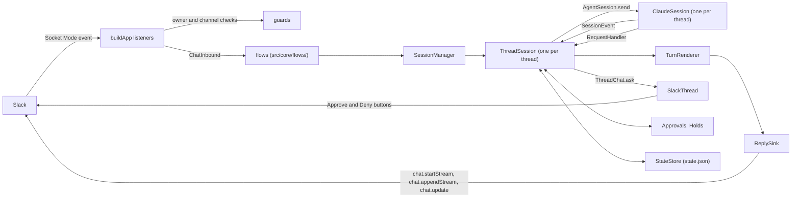

# Architecture

allaboard is one Node process. It drives one agent from one chat: with the modules that ship, a
Slack Socket Mode connection and one Claude Code process per live thread session, across every
bound channel, all on one event loop. The agent and the chat are modules chosen by name (see
"Modules"); the rest of this page describes the two that ship, `claude` and `slack`.

## Overview

One chat thread is one agent session, which is one `ThreadSession` in the daemon holding one live
`AgentSession`: for Claude, a `ClaudeSession`, a single `query()` of the Claude Agent SDK with
streaming input. A message in a thread goes to that thread's session, and what the session sends
back is written into the same thread. Threads of different channels run side by side on the one
event loop, and each thread keeps the folder it was opened in.

A module is a directory of the source that implements one seam and exports one entry for the
registry. The agent module (`src/agent/claude/`) implements the agent seam; the chat module
(`src/chat/slack/`) implements the chat seam. The source is three layers and a registry, wired by
`main`. Six files sit above them and any layer imports them: `src/clock.ts`, `src/log.ts`,
`src/text.ts` (Python's whitespace and its order of strings, where JavaScript's differ),
`src/values.ts` (reading a parsed value or a caught error by what it is), `src/semver.ts` (whether a text is a version and which of two is newer) and `src/version.ts` (the
version that runs, `version.installedVersion`, and the address of a section of its setup guide on
GitHub, `version.setupGuide`, which the texts that send the owner to the guide use, since the
package does not carry `docs/`). Beside the layers,
`src/host/` holds what concerns the machine allaboard is installed on: none of the layers imports it
and it imports none of them; the entry files (`src/daemon.ts`, `src/cli.ts`, `src/updates-host.ts`) do. `test/imports.test.ts`
reads the imports of every source file and fails on one the table does not allow. The rules are
written by layer, so that they hold for a module that is not there yet: the core imports no
module, a module imports no other module, only `src/daemon.ts` imports `src/registry.ts`, only
`src/main.ts` imports `src/daemon.ts` and nothing imports `src/main.ts`, the host layer and the three layers do not import each other, and
a package is imported only by the module that lists it in
`LIBRARIES` (`@anthropic-ai/claude-agent-sdk` for `agent/claude`, `@slack/` for `chat/slack`,
`@inquirer/password`, `@inquirer/input` and `@inquirer/select` for `host`).
The scan reads a specifier written as a string or a plain template, and fails on an `import()` or
`require()` whose specifier is not a literal and on `createRequire`, which it cannot read.

| Layer | Holds | Imports |
|---|---|---|
| `src/agent/` | the agent seam (`src/agent/seam.ts`) and the Claude back end (`src/agent/claude/`): the SDK's query with its options, hooks and permission callback, the translation of its records into events, folder trust, the session listing, the usage probe | the back end is the only code that imports `@anthropic-ai/claude-agent-sdk`; nothing of the core or of the chat layer |
| `src/core/` | the sessions, the flows (`src/core/flows/`: a message, a word, a request to the owner, a list, the crash repair), the port a provider calls (`src/core/port.ts`), `state.json`, the model of a reply, the pending requests and holds, the daemon's words and texts, the configuration and the wizard that writes it (`wizard.answerWizard`), the lock | the two seams; neither library, and nothing under `src/agent/claude/` or `src/chat/slack/` |
| `src/chat/` | the chat seam (`src/chat/seam.ts`) and the Slack provider (`src/chat/slack/`): the listeners and their guards, the reply sink, the root's reaction and the thread's status line, the Home tab, files, the provider's own texts | the provider is the only code that imports `@slack/bolt` and `@slack/web-api`; the agent seam's types and, of the core, the port alone; never the back end |
| `src/registry.ts` | the agents and the chats the daemon can run, by name | the two modules: the one file outside them that names them |
| `src/host/` | the machine allaboard is installed on: the program a service starts (`host/program.programOf`), the service itself behind `host/service/seam.ServiceManager`, implemented for launchd (`host/service/launchd.Launchd`: the LaunchAgent `local.allaboard`), the commands it runs (`host/run.runCommand`, and `host/run.runAsync` for npm), what it asks of npm (`host/npm`, see [Updating allaboard](#updating-allaboard)), and the terminal `allaboard setup` asks on (`host/prompter.askTerminal`, `host/prompter.chooseTerminal`) | Node's built-ins, `@inquirer/password`, `@inquirer/input`, `@inquirer/select`, `src/log.ts`, `src/semver.ts` and `src/version.ts`; none of the layers |
| `src/cli.ts` | the command line: no argument runs the daemon; `--version`, `--help`, `service install\|uninstall\|status\|restart\|list`, `update [--check] [--yes]` and `setup [--instance <name>]` answer and end; any other argument is refused with status 2 | the host layer (`host/prompter` among it), `src/version.ts`, `src/semver.ts`, `src/registry.ts` (the modules `setup` offers), and from the core `core/config.CONFIG_DIR`, which `service uninstall` names, `core/lock.updateLock` and `core/wizard.answerWizard` |
| `src/module-setup.ts` | the types of what `allaboard setup` asks for a module (`ModuleSetup`, `SetupQuestion`, `Check`), which both seams use | imports nothing; `src/agent/seam.ts`, `src/agent/claude/module.ts`, `src/chat/slack/onboarding.ts`, `src/core/port.ts` and `src/core/wizard.ts` import it |
| `src/updates-host.ts` | the daemon's adapter from the host layer (npm, the service manager, the update lock) to the questions the core asks of the machine (`core/port/updates.UpdatesHost`) | the host layer, the core's port and lock; one of the entry files, since it imports both sides |
| `src/main.ts` | the entry the package's `bin` and the LaunchAgent name: it has no static import, checks the Node against `node-version.MINIMUM_NODE`, prints a refusal and ends with status 1 on an older one, else loads `src/daemon.ts` | `src/node-version.ts`, `src/log.ts`, `src/daemon.ts` (dynamic imports) |
| `src/daemon.ts` | the startup order and the shutdown | the registry, the core, the command line; neither module |

The core talks to the two libraries through the seams alone. No type of the Agent SDK appears in
`src/agent/seam.ts` and no type of a Slack package in `src/chat/seam.ts`. The same holds for
words: `test/vocabulary.test.ts` fails on an identifier or a string outside the module directories
(`src/agent/<name>/`, `src/chat/<name>/`, read from the disk) and `src/registry.ts` that names an
agent, a chat or what only one of them has: the name of each module directory, and `anthropic`,
`bolt`, `threadTs`, `mrkdwn`, `modal`, `ephemeral`, `emoji` (comments are exempt). A text of the core that names the agent or the chat takes the name from the
module (`texts.Named`, `texts.named`, `texts.namesOf`); the Slack provider's own words are in
`src/chat/slack/texts.ts`.

What crosses the agent seam:

| Crossing | Direction | What |
|---|---|---|
| commands | core to back end | on `AgentBackend`: `start`, `listSessions`, `datedSessions` and `aliveSessions` (with `sessionListing`), `folderTrusted`, `trustedRepository` and `untrustedRepository` (with `folderTrust`), `usageLimits`, `tagSession`, `forkSession` (with `sessionForks`), `sessionTitle` and `close`. On the `AgentSession` a start returns: `send`, `interrupt`, `stopTask` (with `subagents` or `backgroundTasks`), `setPermissionMode`, `setModel`, `setEffort` (with `liveEffort`), `contextUsage`, `loaded` (with `loadedContext`), `info`, `close` |
| events | back end to core | `SessionEvent`, read in order from `AgentSession.events`: the session's id and version, a message's start and end, text as pieces or whole, a call's start and end, a task's life, a compaction, a change of permission mode, effort or folder, a prompt the agent took, word that the coming turn reports a background task (`report_started`), word that the running turn took a task's notification (`notification_folded`), a message from another of the owner's sessions (`peer_message`), usage limits gone stale, a turn's end, an error message of the agent's, a lost process. A turn has no start event, and `turn_ended` is an event like the others, never the answer to `send` |
| requests | back end to core, which answers | `RequestHandler.permission` and `RequestHandler.question`: each resolves once, for as long as the owner takes, with a `PermissionAnswer` or a `QuestionAnswer` |
| declarations | read by the core | `AgentBackend.name` and `AgentBackend.words`, which the texts take, and `AgentBackend.tools`, the `ToolVocabulary` of the tools the terminal shows in words or a preview of its own (also on the `AgentEntry`, readable without a back end; `NO_TOOL_WORDS` for an agent with none), which `Previews` of `src/core/reply/previews.ts` draws and every other tool shows generically, with the names of the commands the core treats on its own (`AgentWords.newSession`, `AgentWords.login`, `AgentWords.logout`: an agent with none leaves a list empty or a name null, and the core refuses and answers nothing for it); `AgentBackend.capabilities`, what the back end supports (`capabilities.CAPABILITIES` for Claude), listed under "Modules" |

What crosses the chat seam, in both directions:

| Crossing | Direction | What |
|---|---|---|
| a reply | core to provider | `ReplySink`: `text`, `task`, `finish`, `closeOut`, `waitLanded`, `settle`. A session holds it as a `Reply`, which adds `rest`, `last`, `overtaken` and `showFooter`. A tool's line crosses as a `TaskUpdate` and the footer as `FooterFields`, which the provider formats |
| a thread | core to provider | `ThreadChat`, one per thread from `ChatProvider.thread`: `openReply`, the root's status (`showStatus`, `clearStatus`, `settleStatus`), the activity line under the last message (`showActivity`, `activityRefused`, `written`), the list of what still runs (`showRunning`), the loop card of scheduled runs (`showLoop`, `endLoop`), the daemon's own lines (`notice`, `tell`, `say`, `rewrite`, `acknowledge`, `link`), a request put to the owner (`ask`, `withdraw`, `keepAnswers`), a reply a stop left open (`endReply`) and `close` |
| a channel | core to provider | `ChannelChat`, from `ChatProvider.channel`: `notice` (which resolves with the id of the message posted, null when the chat cannot say), `say`, `open` (with `threadOpen`: a message that starts a thread, which `!fork` posts), `tell`, `rewrite`, and the lists a word posts (`offer`, `withdraw`) |
| the provider | core to provider | `ChatProvider`: `name`, `capabilities`, `escape` and `channelName` (what a core text relies on to write a name and a channel for the chat's markup, beside `ThreadChat.link`), `openedAt`, `channelState`, `threadState`, `index`, `openFile`, `tagThread`, `titleThread` and `statusMark` where declared, and `start`, `stop` and `close` |
| a request | core to provider | typed by what it asks, never by how it is drawn: `OwnerRequest` is a `PermissionRequest`, a `QuestionRequest`, a `HoldRequest` or a `SetupRequest`; a list is an `OwnerList`, of folders, of sessions or the update of allaboard |
| an owner's act | provider to core | `ChatInbound`: `message` (an `InboundMessage`), `answer` (an `OwnerAnswer` to the request `requestId` names), `picked` (a `ListPick` from an `OwnerList`) and `unbound` (the owner wrote in a channel bound to no folder: the core tells how to bind). The provider calls them for the owner alone |
| a failure | provider to core | `ChatError`, whose name is the provider's code for the failed call |

The core decides what is asked, which choices exist and what follows an answer; the provider
decides how each is drawn, and checks that it was the owner who acted before it calls
`ChatInbound`. A provider reaches the core through `CorePort` (`src/core/port.ts`) and nothing
else of it.

| Part | Owns |
|---|---|
| `main` | the startup order, the instance's folders, the single-instance lock, the build of both modules from the registry, signals and the shutdown drain |
| `registry.REGISTRY` | the agents and the chats by name, and the two names taken when `.env` selects none |
| `flows.buildFlows`, `Inbound` | the core's side of `ChatInbound`: what a message, an answer, a pick and an unbound channel mean and what follows each (`src/core/flows/`: `messages`, `words`, `status`, `asking`, `lists`, `resume`, `bind`, `repair`, `notices`), all answering the owner through `Talk` |
| `CorePort` | what a provider may call and read of the core: the live sessions, `state.json`, the pending requests and holds, the agent's name, words and session listing |
| `SessionManager` | the live `ThreadSession` objects, one per open thread, and what spans them: `!bind`, `!resume`, the drain |
| `ThreadSession` | one thread: its agent session, prompt queue, turns, requests, status and idle close |
| `ClaudeBackend`, `ClaudeSession` | the Claude Code process of a session and everything read from Claude Code's own records |
| `Translator` | turns the records of the SDK's stream into session events |
| `TurnRenderer` | turns the session events into a model of one reply |
| `SlackChat`, `SlackThread`, `SlackChannel` | the Slack provider as the seam sees it: the connection, what a session does to its thread outside a reply (the root's reaction, the status line, a notice, a request's message) and what the daemon says in a channel |
| `ReplySink` (in `sinks`) | writes the model of a reply to Slack as a native stream, then by `chat.update`, and ends it with the footer |
| `app.buildApp`, `guards` | the Slack listeners, one per inbound path (message, button, modal, Home control), in the classes of `src/chat/slack/app/`: they acknowledge, check the owner, the workspace and the channel, read the payload and call `ChatInbound`; `guards` holds the checks each path runs on its own |
| `commands` | the `!word` parser and the daemon's own words |
| `Approvals`, `Holds`, `setup` | the questions the daemon puts to the owner and keeps while it waits: tool permission, a same-folder hold, a session's setup, a shell command's confirmation |
| `StateStore` | `state.json`: the channels, their threads and what crash repair needs |
| `Home` | the app's Home tab, the session index; `ThreadDeleter` serves its edit mode |

One message's way from the chat to the agent and back, with Slack and Claude Code:

1. Slack delivers the event over the Socket Mode connection, which Bolt's `SocketModeReceiver` holds
   (`app.socketReceiver`). `app.buildApp` registered the listener for it when `SlackChat.start`
   opened the connection.
2. Bolt acknowledges an event before its listener runs. The listener then checks the owner and the
   workspace (`guards.isOwner`, through `Answers.fromOwner`) and, in the message's place among its
   thread's (`order.ThreadOrder`), the channel (`ChannelGuard.refusal`, through
   `Answers.channelAllowed`), and reads the payload into an `InboundMessage`
   (`messages.inboundMessage`). The place is taken before the channel check and left when the
   listener has called `ChatInbound.message`, so two messages of one thread are handed over in the
   order their listeners were called although the check takes longer for one than for the other.
   A clip whose transcript is in the file's `vtt` is the exception: `Clips.takeClip` hands it over
   after the download of that file, and a typed reply sent after it can be handed over first.
3. The listener calls `ChatInbound.message`. The message flow (`messages.messages`) reads a message
   that starts with `!` with `commands.parseBang`, as one of the daemon's words (`words.wordFlow`)
   or as a passthrough to a command of the agent. Anything else is a prompt. A top-level message
   opens a session (`SessionManager.open`); a reply in a thread gets that thread's session
   (`SessionManager.get`), rebuilt when a restart or an idle close dropped it. Before the prompt is
   sent, it can wait for the owner: a first prompt for the session's setup, and a prompt that would
   wake an idle session for the same-folder hold, when another session is working in that folder.
4. `ThreadSession.submit` queues the prompt. The session sends one at a time to its `AgentSession`
   (`ClaudeSession.send`), and one reader task follows `AgentSession.events`.
5. In the back end, `Translator.translate` makes session events of each record the SDK's stream
   yields. The reader gives each event to a `TurnRenderer`, which keeps the model of the reply. The
   `ReplySink` the session got from `ThreadChat.openReply` writes that model into the thread and
   ends the reply. The footer is the session's: once the session has ended everything, it goes
   under the reply that holds the session's latest work (`Reply.showFooter`).
6. When Claude Code needs permission, the SDK calls `canUseTool`. The back end makes a request of it
   (`requests.toRequest`) and asks the session's `RequestHandler`; the session posts it through
   `ThreadChat.ask`, as a message with Approve and Deny buttons. The click comes back through
   steps 1 and 2, read into an `OwnerAnswer` and given to `ChatInbound.answer`, where the answers
   flow (`answers.answersFlow`) checks it against the request it names and settles it.

Terms used throughout:

| Term | Meaning |
|---|---|
| module | An agent or a chat: a directory that implements a seam and exports an entry the registry holds under a name |
| entry | What the registry holds for a module: the variables it reads and the function that builds it (`AgentEntry`, `ChatEntry`) |
| capability | A way modules differ that the core adapts to, declared by the module (`Capabilities`, `ChatCapabilities`); a feature a module does not declare is not offered |
| flow | Behaviour of the core outside a session's turns, in `src/core/flows/`: what a message, an answer or a pick means, and the repair after a crash. It reaches the owner through the chat seam |
| port | The core as a provider reaches it: `CorePort` and the types under `src/core/port/` |
| thread | A thread of the chat, named by a `ThreadRef` that only the provider can read. With Slack, a Slack thread; its root is the owner's top-level message, or the owner's `!resume` message |
| session | An agent conversation, named by a session id. `ThreadSession` is its live side in the daemon |
| turn | One prompt sent to the agent, and what it does until its result arrives |
| reply | What the daemon writes in the thread for a turn |
| report turn | A turn the agent starts by itself to report a finished background task |
| bypass | The permission mode that skips permission requests (`bypassPermissions` in Claude Code), kept per thread and set with `!bypass` |
| root reaction | With Slack, the reaction on the thread's root message that shows the session's state: ⏳ working, ✋ waiting for the owner, ✅ ended, ❌ error, 🔄 a restart waits for it |
| drain | The wait at shutdown for the turns already sent to finish |
| record | One object of the SDK's stream, as Claude Code wrote it |
| event | A `SessionEvent` of the agent seam, which the back end makes from records and hook inputs |

To learn what the daemon does and what it refuses, read this overview, then "Who may talk to it",
"Approvals", "Rendering" and the opening of "Sessions". To add or read a module, read "Modules".
The other sections are internals for someone changing the code: "Startup", "State and the
single-instance lock", "Footer" and the rest of "Sessions". The limits those sections quote from
Slack and the SDK are gathered, with their dates and versions, in "Measured platform behaviour" at
the end. For when a channel or a thread leaves the state file, read "When a thread leaves
`state.json`".

The Slack provider has a page of its own, [slack-provider.md](slack-provider.md), also for someone
changing the code: [Writing to Slack](slack-provider.md#writing-to-slack),
[Opening a file](slack-provider.md#opening-a-file),
[The session index](slack-provider.md#the-session-index) and
[Slack handlers](slack-provider.md#slack-handlers).

## Modules

An agent and a chat are modules: each is chosen by a name in the instance's `.env` (`~/.config/allaboard/.env` for the default instance) and built
at start. Two ship, the agent `claude` and the chat `slack`.

`registry.REGISTRY` (`src/registry.ts`) maps a name to an entry. `Registry.agents` holds
`AgentEntry` values (`src/agent/seam.ts`), `Registry.chats` holds `ChatEntry` values
(`src/core/port.ts`) and `Registry.defaults` the two names taken when the file selects none.
`ALLABOARD_AGENT` and `ALLABOARD_CHAT` select; absent, they mean `claude` and `slack`, so an `.env`
written without them works as it did. `config.loadConfig` stops the start with a `ConfigError`
that lists the valid names when one selects a name the registry does not hold. `daemon.run` builds
the selected entries and imports neither module; a test passes its own registry in
`RunOptions.registry`, and what a test replaces inside a module is an option of that module's
entry (`slackChat`, `claudeAgent`).

An entry names the variables its module reads (`required` and `optional`) and builds it.
`AgentEntry.build` returns an `AgentBackend` from an `AgentContext` (the module's variables and a
clock). `AgentEntry.executable`, when a module gives it, names the agent's own command (`claude`):
`allaboard service install` receives the commands of the registry's agents, and
`host/program.programOf` keeps the ones its terminal's `PATH` finds, whose folders
`host/program.servicePath` puts on the service's `PATH`. `ChatEntry.build` returns a `ChatProvider` from a `ChatContext`: the variables, the folder
sessions may start under, the instance's scratch folder (`ChatContext.scratchDir`), two clocks, and `ChatContext.core`, which returns the `CorePort` once
the daemon has built its sessions. The chat is built before the sessions exist, so `build` must
not call `core`; a provider calls it when it first needs the core. `ChatEntry.setup` and `AgentEntry.setup`, when a module gives them, are what `allaboard setup`
asks for that module (`ModuleSetup`, in `src/module-setup.ts` since both seams use it: intro
lines and questions, each with its check and the variables it may set, `sets`); the core runs the
flow and writes the file. It takes `SetupModules` (`chats` and `agents` by name, as the registry
holds them, and the `defaults`), asks which chat and which agent through `Prompter.choose` (a
list, the default first and preselected, shown even when it holds one name), and writes the two
selectors as picked. A chosen chat with no `setup` is refused; a chosen agent with none asks
nothing more. The chosen chat's questions come first, then `ALLOWED_ROOT`, then the agent's. The
service question is a list too (Yes, No). `test/setup-coverage.test.ts` fails
for a wizard that does not ask a selector or leaves out a variable the core requires, and for a registry entry that declares a variable its setup neither asks nor sets. A check that sets a variable its
question did not declare in `sets` is refused by the wizard when it runs (`test/core/wizard.test.ts`). `config.loadConfig` gives a
module the values of its own variables only, and a required one that is missing stops the start.
The Claude entry requires none and reads `BASH_DEFAULT_TIMEOUT_MS` and `CLAUDE_CONFIG_DIR`, variables
of Claude Code that it hands to each thread's session. `CLAUDE_CONFIG_DIR` is the folder of a login
of its own: the entry expands it (`~` is the home), refuses a relative path with an
`AgentConfigError`, which the daemon logs as it logs a `ConfigError`, and gives it to the trust,
Chrome and listing code that read Claude Code's records. It also writes it into the daemon's own
environment once, when it builds, because the Agent SDK's `listSessions` has no option for the
folder and reads the environment alone; the Slack entry requires `SLACK_BOT_TOKEN`, `SLACK_APP_TOKEN`
and `SLACK_OWNER_USER_ID` and reads `SLACK_USER_TOKEN`. A module reads each of its variables by
name: `loadConfig` gives them readable by lookup and not enumerable, so that nothing prints them.

A capability names a feature that the core offers only when the module supports it. A module
declares what it supports; for a feature it does not declare, the core does not offer the feature
and never calls what serves it. The core invents no substitute. What every module does
alike needs no capability. `effortLevels` and
`permissionModes` are values, not switches, and their rows say what the core reads them for.

`!guide` is made of parts (`src/core/guide.ts`, `guideText`), and the words `!help` lists follow
the same capabilities. A part appears when the pair declares what it describes: `folderTrust`,
`models`, an agent with effort levels, a `bypass` mode, `commands`, `questions`,
`backgroundTasks` and `sessionListing` of the agent, and `fileUpload` and `threadTags` of the chat.

| Agent capability | What the core does without it |
|---|---|
| `effortLevels` | the levels `StartOptions.effort` and `AgentSession.setEffort` take; a stored level outside them is dropped, with a line in the log, and the setup offers them as its Effort control when `models` is not declared |
| `liveEffort` | the setup starts a fresh agent session to change the effort, since no prompt has been sent |
| `permissionModes` | the modes by role (`default`, `auto`, `bypass`); with `bypass` null the setup offers no Bypass checkbox and `!bypass` answers that the agent has no such mode (`texts.BYPASS_UNAVAILABLE`) |
| `subagents` | an event that runs under a call of its own, or a task that is a subagent's, is ignored, with a warning in the log |
| `backgroundTasks` | a task that outlives its turn, and the turn the agent starts to report it, are ignored; the session tracks and waits for none |
| `foldedNotifications` | a task that ends inside a turn counts as reported by that turn; the reply is closed out, with the footer, when the turn ends, and a report turn the agent opens afterwards gets a reply of its own. With it, such a task is owed a report turn until `notification_folded` names it (see "A report turn after the turn a task ended in") |
| `compaction` | the compaction events are ignored |
| `declaredState` | a `state_changed` event is ignored, with a warning in the log; the thread's activity line says `Working…` for the owner's prompts alone, so a turn the agent starts by itself shows none |
| `questions` | `!guide` leaves out the sentence about the question form and titles its approvals section "Approvals"; no other code of the core reads it, and the conformance suite runs its question checks only for a back end that declares it |
| `usageLimits` | `AgentBackend.usageLimits` is absent and the footer shows no limit |
| `sessionTags` | `AgentBackend.tagSession` is absent and `!tag` and `!untag` change the chat's tag alone; a thread whose session has no id yet is tagged in the chat alone as well. A rejection of `tagSession` leaves the chat's tag and is told to the owner (`texts.TAG_AGENT_FAILED`) |
| `sessionTitles` | `AgentBackend.sessionTitle` is absent: the core shows no title on the root and `!status` has no `Title:` |
| `goals` | a `goal_changed` event is ignored, with a warning in the log: a reply shows no goal line, `!stop` never says a goal is still set, and a channel's `!stop` drops no goal (`AgentSession.clearGoal` is never called) |
| `models` | `AgentInfo.models` is ignored: the setup has no Model select and `AgentSession.setModel` is never called |
| `commands` | `AgentInfo.commands` is ignored: a `!name` that is no word of the daemon is sent as typed, and `!help` lists no command of the agent |
| `promptDuringTurn` | the next prompt is sent once the running turn has ended |
| `sessionListing` | `!resume` answers that the agent keeps no list of its sessions (`texts.RESUME_UNLISTED`), and the cleanup never drops a thread for a session it cannot find. The Slack Home tab does not check it: it calls `AgentBackend.listSessions` through the port (`HomeAgent`) for the titles of the threads it lists |
| `folderTrust` | every folder counts as trusted, `!bind` offers every folder under the root (`texts.BIND_LIST_ANY`; the notice of an unbound channel, `texts.UNBOUND_ANY`, and the `!bind` line of `!help`, `texts.HELP_WORDS_ANY`, say nothing of trust either), and the daemon's own git runs in no folder, so the footer shows no branch and no changes |
| `loadedContext` | `AgentSession.loaded` is absent: `!memory` and `!skills` answer that the agent does not list what a session loaded (`texts.LOADED_UNAVAILABLE`), and neither `!help`, the suggestions nor `!guide` offer them |

| Chat capability | What the core does without it |
|---|---|
| `nativeStreaming` | the renderer holds the pieces of a text and hands the reply sink each text whole |
| `reactions` | the session asks for no status on the root, a word that took effect is not marked, the crash repair sets no error status, `ChatProvider.statusMark` is absent and a channel's `!status` writes each session's status as a word |
| `activityLine` | the session shows no activity line, and no message says that a restart waits |
| `fileUpload` | `ChatProvider.openFile` is absent and `!open` answers that the chat cannot show a file (`texts.OPEN_UNAVAILABLE`) |
| `threadTags` | `ChatProvider.tagThread` is absent, `!tag` and `!untag` answer that the chat cannot tag a thread (`texts.TAG_UNAVAILABLE`), and `!help` and `!guide` leave them out |
| `threadTitles` | `ChatProvider.titleThread` is absent and the core reads no title for the root, whatever the agent declares |
| `threadDelete` | `ChatProvider.deleteThread` is absent, `!delete-thread` answers that the chat cannot delete a thread (`texts.DELETE_THREAD_UNAVAILABLE`), and `!help` and `!guide` leave it out |
| `commandSuggestions` | `ChatProvider.suggestCommands` is absent: a `!word` that is no command goes to the agent as typed, and `!` alone is a prompt. With it, and with the agent's `commands` capability, `submitToSession` stops, inside a session's thread only, a word the session does not list (name or alias) right after `ensureConnected`: before the setup and the same-folder hold when the session is connected or never ran, after the hold when it ran and was closed (so a Cancel starts no process). It ranks the candidates (`commands.commandPool`, `commands.rankCandidates`) and hands them over; nothing reaches the agent. What the owner sends from the suggestion comes back through `ChatInbound.message` as an ordinary message |

A chat is required to receive a message, to write a reply it can edit, and to put a request or a
form to the owner, and a session is a thread: none of these has a capability. Two things a chat
may lack have none either, because the core does nothing differently without them. A chat with no
index of the sessions leaves `ChatProvider.index` out, and `main` asks for none. A chat that
cannot show a line to the owner alone posts what `ThreadChat.tell` and `ThreadChat.say` hand it
as messages of the thread, which show the same text.

The core reaches a provider only through `src/core/port.ts`. `CorePort` has the members
`sessions`, `state`, `approvals`, `holds` and `agent`, each a set of `Pick` types over the class that
answers, declared in a file of `src/core/port/` for the flow of the provider that uses it, so the
classes themselves are the implementation. What a provider reads of a live session or a pending request is a plain value: `SessionManager.live` (whether the thread has a session), `Approvals.questions` (the questions of a request, read from the thread it was posted in) and `Holds.atMessage` (the id of the open setup a message shows). No `ThreadSession` and no `Pending` reaches a provider. The same file exports `ChatContext`, `ChatEntry` and the
values of the core that a provider's own code works with.

Two tests hold the boundary. `test/imports.test.ts` allows a chat provider to import the chat seam,
the agent seam's types and the core's port, and refuses any other import of the core, an import of
any other module, of the registry or of `src/daemon.ts`, and an import of a package outside the
module that lists it. `test/vocabulary.test.ts` refuses a word of one module outside it. A new
module adds its package to `LIBRARIES` in the first test, and the words only it has (not its
name, which comes from its directory) to `MODULE_WORDS` in the second.

A conformance suite per seam runs the same checks against both implementations of that seam:
`test/conformance/agent.ts` against the Claude back end (over the recorded SDK streams) and the
plain agent, `test/conformance/chat.ts` against the Slack provider (over its fake client) and the
memory chat. The plain agent (`test/support/plain-agent.ts`) declares few capabilities: no
subagents, background tasks, compaction, usage limits, model list, bypass mode or record of trust,
and one permission mode. The memory chat (`test/support/memory-chat.ts`) declares none. A scenario under
`test/scenario/` runs the daemon with the two selected by name. The fake workspace reads a
stopped stream back as Slack does for one run of plain words (the recording
`api-conversations-replies-stream`); marks, cards and other chunk shapes read back no blocks, and
the tests of the provider's own `endReply` cover them with recorded reads.

Tests keep to the same layers. `test/core/` and `test/chat/` use the plain agent and the memory
chat and never reach `src/agent/<module>/`, directly or through a file of `test/support/` or of `src/` (`src/registry.ts`
imports the modules); `test/vocabulary.test.ts` follows every relative import, bare ones included.
A test of the configuration the daemon ships (`test/config.test.ts`) names the registry and lives at
the top of `test/`. A test that runs the core or the Slack provider
over Claude's recorded streams, tool vocabulary, trust record or model list is a test of the Claude
module and lives under `test/agent/claude/`: the sessions (`sessions/`), the Slack app handlers
(`slack-app/`), the reply over the recordings and the golden files (`reply/`), the folder trust
under the footer's git and `!open` (`files/`, `footer-git.test.ts`). `test/conformance/` and
`test/scenario/` run every module the registry names.

Not tested: a module other than these. No second real agent or chat ships, and the seams were
shaped on the two test modules, so a first real one may need a seam change. With Claude and Slack
the behaviour was compared by the existing suite and the golden files; on 2026-10-11 the daemon had
not been run against a real Slack workspace with the modules in place.

### What an agent must do that the types do not say

The types of `src/agent/seam.ts` give the members. These are the rules the core relies on beside
them. A rule the conformance suite checks names the check; one it does not check is marked, and a
module that breaks it fails only in use.

| Subject | Rule | Checked by `test/conformance/agent.ts` |
|---|---|---|
| A tool the terminal words | `AgentBackend.tools` names, by the agent's own tool names, the tools whose calls the terminal folds in words, whose file changes it previews (the title for a change to an existing file; a created file shows its content under the tool's name), whose calls a reply holds until they end (`askers`, `launchers`), whose failure it counts with the others, and the input keys it titles or times a call by. The core draws exactly what is declared and shows any other tool as its name and its line; `plan` names the tool whose approval asks for a plan, and the core hands the chat the plan as `ApprovalRequest.plan`. `AgentEntry.toolNames` lists every tool name the agent is known to offer; none of them, and none of the vocabulary, appears as a string literal under `src/core/` or `src/chat/`, but in a constant `test/vocabulary.test.ts` lists by name (a task kind's label, a button's) | not checked: the plain agent (`PLAIN_TOOLS`) and `test/core/reply/vocabulary.test.ts` prove the core draws a vocabulary of another agent |
| A command | The owner types `!name args`. When `name` is the `name` of an entry of `AgentInfo.commands`, the agent receives the prompt `name args` behind `AgentWords.commandPrefix` (`/` for Claude Code; the message flow, `messages.messages`); an alias does not match, and any other `!text` arrives as typed. A name in `AgentWords.newSession` is refused inside a thread, and the names in `AgentWords.login` and `AgentWords.logout`, and those in `AgentWords.notOffered` that the session's own list does not have, are answered by the core (`commands.notOfferedAnswer`): none of them reaches the agent | `a command's output arrives whole, once, and uses no model`; nothing checks the text that arrives as typed |
| The effort | `effort_observed` and `effort_changed` come before the `turn_ended` of their turn: `ThreadSession.showFooterIfEnded` builds the footer once the session has ended, from what it has by then. Null is the agent's default | Not checked: only that a level is one of `Capabilities.effortLevels` |
| The model | `model_changed` carries the id of the model the agent runs after a switch (a command, `setModel`, a fallback, a resume) and comes before the `turn_ended` of the command's turn, ahead of a `contextUsage` that after a command still names the model before it. Needs `models` | `a command that switches the model says so before the turn ends`; a back end without `models` emits none (`assertDeclared`) |
| A goal | `goal_changed` says what became of the goal the owner set with the agent's command: `set`, `not_met` (the agent goes on working for it), `achieved` with the counts it gives, or `cleared`. A check and an achievement come before the `turn_ended` of the turn they belong to; the core draws them in that turn's reply and keeps the condition of a set goal in memory for `!stop`, which names `AgentWords.goalClear` when the agent has one. The agent's own command says when a goal is set or cleared. `clearGoal` is called on an idle session only, after a channel's stop, and shows no event. Needs `goals` | a back end without `goals` emits none (`assertDeclared`) |
| What the stop hooks said | `stop_hooks_ran` says what the owner's stop hooks said at a turn's end: how many ran, why one stopped the session, what each that refused to end the turn said and what each added for the agent. It comes before the `turn_ended` of the turn it belongs to, after the words written before it; the core draws `Ran N stop hooks`, then the reason for stopping, a `Stop hook error:` line for each refusal and a `Stop hook feedback:` line for each added context, as a line of that turn's reply (`stopHookLines`), every further line indented under the first and passed through `ChatProvider.escape`, so it shows as the hook wrote it. A goal's failed check is a `goal_changed`, never this event | Not checked |
| Who started a turn | `turn_ended.startedBy` is `owner` for a prompt's turn and `agent` for one the agent starts by itself, to report a task or to answer another session's message. `report_started` names the task before such a turn's words, and needs `backgroundTasks` | `startedBy` is checked for a prompt's turn only |
| A notification folded | An agent that declares `foldedNotifications` emits `notification_folded` with the task's id when the running turn takes that task's notification, after the task's end and before the turn's `turn_ended`; it emits none for a task whose report the agent opens a turn for, and needs `backgroundTasks`. `task_ended.foldNamed` says per task whether it can: false when the SDK gave the run no id | Only that a back end that lacks `foldedNotifications` emits none (`assertDeclared`, run on the turns of the suite) |
| A prompt taken | An agent that declares `promptDuringTurn` emits `prompt_taken` with the `Prompt.id` of each prompt it accepts, before that turn's words, whether it took the prompt into the running turn or as the next one | `a prompt taken is named by its id, before the turn's words` |
| `interrupt` | The running turn ends with `turn_ended` whose `ending` is `interrupted`, and the session stays usable. With no turn running it resolves and ends nothing. The core has no timer for a turn that never ends after it | `interrupt ends the turn as interrupted, and the session goes on` |
| `stopTask` | The task's line closes only when the agent then sends `task_ended`, or `task_updated` with `terminal` and a status. Until then the reply that holds the line stays open | Not checked |
| `setEffort(null)`, `setModel(null)` | Null is the agent's default. The core calls `setEffort` only with `liveEffort` and `setModel` only with `models`, and never `setModel(null)` | `setEffort takes a declared level or null, and refuses another`, `setModel takes a listed model or null` |
| The default model | The entry of `AgentInfo.models` with `ModelInfo.isDefault` stands for the model the agent picks when none is chosen. The setup draws it as the default choice (`setup.DEFAULT`) and sends nothing to `setModel` for it; the names of the core skip it (`models.modelName`, `models.settingName`) | `the default entry is the one the list marks, whatever its value` |
| `setPermissionMode` | A mode the agent refuses rejects. The core then changes nothing of its own: the bypass it stores is written only after the call resolves | `a permission mode the back end names is taken, another is refused` |
| `session_started` | Emitted only once a start that resumes that id would succeed: the core stores the id when the event arrives, and the setup's Start may resume it before any prompt | `an id that session_started names can be resumed at once` |
| A request | `RequestHandler.permission` and `RequestHandler.question` each resolve once. The agent passes a signal and aborts it when it no longer waits: the core takes the request back from the owner and resolves it as refused | `a request the agent gives up aborts the signal it passed, and the turn goes on to its end` |
| A start that fails | `ResumeRefused`, the one error class of the seam, when the session a start names cannot be resumed: the core forgets the thread. Any other rejection is shown to the owner by its name and the next message tries again. Neither leaves a process running | `a resume the agent refuses rejects with ResumeRefused and leaves no process` |

Members that serve a capability are optional on the type and present exactly when the module
declares it (a conformance check asserts that): `listSessions`, `datedSessions` and
`aliveSessions` with `sessionListing`; `folderTrusted`, `trustedRepository` and
`untrustedRepository` with `folderTrust`; `AgentSession.setEffort` with `liveEffort`;
`AgentSession.stopTask` with `subagents` or `backgroundTasks`; `AgentBackend.usageLimits`,
`AgentBackend.tagSession`, `AgentBackend.sessionTitle` and `AgentSession.loaded` with theirs. The
core checks the capability and the member before it calls one; a module that declares
`folderTrust` with no `folderTrusted` has no folder trusted. `AgentInfo.models` is an empty list
without `models`. `AgentWords.terminal` is null for an agent with no terminal to continue in: the
core answers `!terminal` with `texts.TERMINAL_UNAVAILABLE`, leaves the terminal line out of
`!status` and does not look for terminals that hold a session. `SessionEvent.peer_message` needs
no capability: an agent whose sessions cannot message each other never emits it.

### What a chat must do that the types do not say

| Subject | Rule | Checked by `test/conformance/chat.ts` |
|---|---|---|
| The owner check | Every inbound path checks that the owner acted before it calls `ChatInbound`, and the core never checks. What "the owner" means is the provider's: the Slack provider requires the configured user and the workspace it started in (`guards.isOwner`) | Three checks send a message, a click and a pick from somebody else. Nothing checks a second workspace |
| Start and stop | `ChatProvider.start`, `stop` and `close` are called once each, in that order. Before `start` the daemon already calls `thread`, `endReply`, `withdraw`, `showStatus`, `channelState`, `threadState`, `openedAt` and the index's `refresh`, for the crash repair and the cleanup. `ChatEntry.build` must not read the core | `nothing arrives before start`, `nothing arrives after stop` |
| A reply | `text` and `task` come while the turn runs. `finish` ends the body, and may come more than once for one reply, since a report turn writes into the reply that started its task when that reply is last. `rest` says the reply waits for work its turn started: from then on it changes by rewriting its message, so that the list of what still runs can show under it; its stream stops with no footer. A reply counts as at rest once `finish` ran and `rest` was called or its end landed, and not before. `closeOut` ends the reply once, with no footer, and answers whether the end landed. `Reply.showFooter` draws the session's footer under the reply once the session has ended, and answers whether it landed; a reply whose end did not land takes none, and drawing it again changes nothing. A reply that has another reply's message below it (`Reply.overtaken`), or that rested, is not `last` and got no text of the agent's since it rested, ends in the message it is in, by edit, and opens no message. `waitLanded` is asked only after a `closeOut` that answered false. `settle` brings the reply to its true form now, at a close. A signal given to any of the four releases the caller only: the write goes on | `carries text, a task line and a footer to its end`, `a reply at rest shows no footer; the session's footer goes under its report`, `the session's footer is drawn once, under the reply it is drawn on`, `a footer drawn earlier stays above the owner's later message`, `reports an end that did not land`, `a reply knows when the owner or another reply wrote below it`, `a reply with another reply below it ends where it is, by an edit, with no footer`, `an ended reply with the owner below it is not last` |
| A task line | `task` with an id already sent updates that line | The same id is sent twice; nothing checks that one line results |
| A line of the daemon's | `text` with `notice` is a line of the daemon's own, and with `ending` the line that says how a reply was cut short | Not checked |
| Markup | The core writes a notice (`tell`, `rewrite`, `ChannelChat.notice`) and a reference (`say`) and names which one (`Markup`). Its texts use backticks and Markdown emphasis. `ChatProvider.escape` makes a name safe for one markup (a third kind, `words`, is the owner's own text drawn in a reference: only the chat's control characters are escaped and its formatting marks stay live), `ThreadChat.link` writes a link to a thread or answers null, and `ChatProvider.channelName` writes a channel | `leaves a plain word alone when it escapes it`, `link is a string or nothing` |
| Ids | `MessageId` and `ThreadRef` are strings the core stores in `state.json` and hands back after a restart: the crash repair ends a reply and withdraws a request by the ids a previous process stored | Not checked across a restart |
| A request | `ThreadChat.ask` resolves with the id of the message that shows the request, or rejects with `ChatError`; the core then refuses the request. `withdraw` answers true for a request that is already gone. A click on a withdrawn request may still reach `ChatInbound.answer`, which answers false after telling the owner | `ask rejects with ChatError when it could not show the request` |
| A status | The core hands `showStatus` one of four words and stores the same word, with `notify` on the change that ends the session's work (`status.endsWork`) unless the owner's own act made it. What the word looks like, and how the owner is told, is the provider's | Skipped for a chat without `reactions` |

Not settled by the seam, by the core or by a check: who drops an event the chat delivers twice
(neither the Slack provider nor the core does), and what a provider does with a click on a
request it already withdrew.

## Startup

`daemon.run` starts the daemon in this order. It is the one module that wires all three layers, and
every store and clock the layers use is built here and handed down; the registry is the only way it
reaches an agent or a chat.

1. It loads the configuration (`config.loadConfig`) from the instance's configuration folder, for
   the modules the registry holds, so a bad `.env` or a name it does not hold fails before
   anything else.
2. It takes the single-instance lock of the instance's configuration folder
   (`lock.singleInstance`), so a second daemon of the same instance fails before it opens a Socket
   Mode connection.
3. It reads `state.json` (`StateStore`, given the names of the agent and the chat selected) and
   builds the selected agent from the registry (for Claude, the `ClaudeBackend`).
4. It builds the selected chat from the registry (for Slack, `module.slackChat`, whose `build`
   reads the core only once it is used): the two Slack clients (`module.makeClients`: `clients.sharedClient` for every call but a
   reply's, `clients.repliesClient` for replies), `auth.test` for the workspace id and the bot
   user id, the `SlackChat` with the shared `UpdateLimiter` and the channels' `ChannelLine` (see the Slack
   provider's "Pushes and threads"), the `ThreadDeleter` when the owner's
   user token is configured (`module.deleter`, which calls `auth.test` with that token), the
   `Home`, the `ChannelGuard` and the attachments folder (`attachments.prepareUploads`, see
   "Attached files"). The provider's `ChatProvider.identities` (for Slack two keys: the workspace and the bot,
   `<team id>:<bot user id>`, and a SHA-256 of the app-level token, `app-token:<hex>`) are known
   from here, and `daemon.run` takes the second lock on each of them (`lock.chatIdentityLocks`, see
   "State and the single-instance lock") before anything else starts. A daemon that finds one held
   lets go of what it built (`ChatProvider.stop` and `close`,
   `AgentBackend.close`; nothing is connected yet, since `SlackChat.start` is what opens the
   Socket Mode connection) and ends with `lock.ChatIdentityTaken`, the same status as
   `lock.AlreadyRunning`, which it extends.
5. It builds the `UsageCache` over `AgentBackend.usageLimits` when the back end has one (for Claude,
   `UsageProbe` is the back end's own and `AgentBackend.close` ends it), then `Approvals`, `Holds`
   and the `SessionManager`, and the flows over them (`flows.buildFlows`), whose `Inbound` the
   chat is given at its start. `SessionManager`, `StateStore`, `Approvals`, `Holds` and the agent
   together are the core the provider reaches through `CorePort`, which is set last.
6. It installs the `SIGTERM` and `SIGINT` listeners (`daemon.StopSignals`), so a signal that arrives
   during a long repair is caught and not left to the default disposition, which would end the
   process at once.
7. With the connection not opened yet, it repairs what a crashed daemon left open
   (`repair.repair`, see "State and the single-instance lock") and then cleans `state.json`
   (`cleanup.clean`, see "Cleaning `state.json`"). Cleaning runs only after repair, so a pruned
   thread's leftovers are still repaired first, and it runs again every
   `cleanup.CLEAN_EVERY_SECONDS` until a stop begins (`daemon.cleanEvery`). Every pass is requested
   through `cleanup.Cleanups`, which the chat reaches as `CorePort.cleanup` (see "Cleaning `state.json`").
8. It sets `StateStore.onSessionsChange` and, for a chat that has a session index
   (`ChatProvider.index`), asks for the first one (for Slack `Home.request`, see "The session
   index", and `ChannelLine.refresh`, which takes over each channel's line an earlier run left).
9. It starts the chat (`ChatProvider.start`, given the `Inbound`). Slack opens the Socket Mode
   connection there (`SlackChat.start`, which builds the Bolt app with `app.buildApp`). Once
   connected, the daemon posts the version 1 to version 2 upgrade notice to each channel that still
   owes one (`notices.postUpgradeNotices`), as a message of its own, not a reply.

`daemon.main` is the daemon's entry point. A `ConfigError`, a `StateError` or `AlreadyRunning` is logged with
its message, any other failure of `daemon.run` by its name alone, and the process exits with 1. A
rejected promise or an exception nobody handled is logged by its name
(`daemon.installProcessHandlers`). After a rejected promise the daemon goes on. An uncaught
exception stops it the way a `SIGINT` does, with the shutdown below and no drain, and the process
exits with 1, so that launchd, which keeps the service alive, starts a clean daemon and the crash repair runs: Node documents the process as
unsafe to resume after one, and letting Node end it there would skip the shutdown and leave open
replies and a Claude Code process per session. One rejection leaves the daemon running and deaf.
`@slack/socket-mode` 3.1.0 reconnects from its `close` listener without awaiting the call
(`SocketModeClient.delayReconnectAttempt`), and when Slack refuses the app token for good
(`invalid_auth` and the four other codes the client calls unrecoverable) the request for a new
WebSocket URL is rejected there with no event for it. The log then holds
`unhandled rejection: invalid_auth`, and the daemon needs a working token and a restart.

When the network is gone the Socket Mode client asks Slack for a new WebSocket URL again and
again until it gets one. `app.socketReceiver` sets how: the waits start at one second, grow by
1.3 each time, stop growing at `app.RECONNECT_WAIT_SECONDS` (60), and the client never gives up,
so a try follows the one that failed by a minute at most. Left to itself `@slack/socket-mode`
3.1.0 lets the wait grow with no limit: with the network gone for two hours it tried 30 times,
the last wait 26 minutes (run on mocked timers, 2026-10-10). The log holds
`socket mode: reconnecting`, then one warning per failed try.

Logs are lines on standard error (`log.getLogger`), which the LaunchAgent writes to
`~/Library/Logs/allaboard/allaboard.log` (`~/Library/Logs/allaboard/<name>.log` for a named instance). A line reads `<time> <LEVEL> <name>: <message>`, the time
local, the name that of the module (`allaboard.core.state`); lines below `INFO` are not written, and
nothing in `src` calls `log.setLevel`, the only way to lower the threshold. A line carries ids, counts and error names, never the
text of a prompt or of a reply. The Slack libraries are given loggers that never write their own
text (`quiet-logger`), since it can quote a message and, at the debug level, the Socket Mode ticket
in the WebSocket URL: the web clients write nothing, Bolt and the Socket Mode client one line per
warning or error that names the library, and the daemon logs the states of the connection itself.

### Shutdown

`SIGTERM`, which `launchctl kill TERM` and `launchctl bootout` send, starts a drain
(`SessionManager.drain`):

- It lets the turns already sent finish, each up to its reply's end (the stream's stop), and the background tasks with the turns that report them. A task whose end came without
  its notification is waited for `constants.INJECTED_TURN_WAIT`, since the CLI can suppress the
  notification. No other turn is sent.
- A new prompt gets `texts.RESTARTING` and, under it, the threads the stop still waits for
  (`Talk.refuseRestarting`, from `SessionManager.restartHolds`).
- A queued turn is dropped without a reply of its own (`ThreadSession.dropQueued`). One note
  (`turn.notSent`, `N messages were not sent because allaboard restarted: send them again.`, with the
  start of each) is added to the end of the thread's running reply, or posted as a message of its
  own when nothing runs.
- Approvals and questions stay open: the Socket Mode connection closes only after the drain. A
  same-folder hold or a setup still open is cancelled, as `!stop` would.
- A thread left with only background tasks says `texts.RESTART_WAITS` in its status line
  (`ThreadSession.threadLine`, brought up to date by `ThreadSession.showRestartWait` at every poll
  of the drain), naming them by their counts (`1 shell`, `2 agents`), since the daemon cannot tell whether a task (a
  dev server, a watcher) ever ends. A status line does not notify and goes with the restart, where a
  message would do both. Where Slack refuses the app a thread status (`ThreadChat.activityRefused`),
  one message says it (`texts.RESTART_WAITS_MESSAGE`). `!stop` while a turn runs interrupts
  it and ends the tasks with `AgentSession.stopTask`; Claude Code starts no turn to report a task
  stopped this way (measured: "Stopped task, no report turn"), so neither the drain nor the
  thread's next prompt waits `constants.INJECTED_TURN_WAIT` for one. `!stop` with no turn running
  does not use `stopTask`: Claude Code opens a turn of its own 1 to 2 seconds after such a stop,
  to react to the tasks, and the agent goes on (measured 2026-10-18, CLI 2.1.302).
  `ThreadSession.stop` closes the agent's process instead
  (`dropClientLocked`, the path of an effort change), which ends every task of it (measured: none
  survives), and draws each task's end itself. It does the same when no task runs but a report turn is owed (`ThreadSession.reporting`, or a notification waiting for its turn): what waited on that report ends as when none comes, and a turn that started while the stop waited for the connect lock is interrupted instead. Before it closes, it starts the read of the context usage
  the footer needs, without waiting for it: the footer names the model and context of that read
  when it answered before the process ended (the SDK rejects a request still pending when the
  query closes, sdk.mjs 0.3.302, and has no timeout for one). Otherwise it names those of the
  last live read the session made (`lastContext`, kept by every footer and `!status`, and by one read made when a
  turn ends while its footer waits for background work, since the stop's own read loses the race
  against the close with the real CLI (measured 2026-10-18, Claude Code 2.1.302; `keepContext`:
  one request per turn, delaying nothing, voided by a model switch or compaction that comes
  before its answer); a resumed
  process's first read replaces it, and a model switch or a compaction drops it, since its share
  no longer holds), and none when the session never made one; a warning is
  logged when the read did not answer. It denies and withdraws the approvals a background agent waits on, as a stop
  of a running turn does. It holds the connect lock until the ends are drawn, so no process
  resumes in the middle of them. The session keeps its thread, id, bypass and effort, and
  `ensureConnected` resumes it at the next message. `!stop` typed in the channel stops its
  sessions together (`SessionManager.stopChannel`), since each close waits for its process to exit (2.0 s until the stream ended, measured 2026-10-18 on SDK 0.3.302). The
  resumed process reports each lost task as `stopped` and ends a turn with `num_turns` 0 and no
  text (`test/fixtures/sdk/stop-close-resume.jsonl`). Nothing about the stop is stored, so a
  session object made after an idle close or a restart must treat it alike: until the first turn
  of a process that resumes a session (`resumedAtStart`), `dispatch` drops the events of a task
  the session does not track, and the core opens nothing for the empty turn (`saidNothing`), so
  the prompt sent as the process opens is answered in a reply of its own. The same rule means a
  background task cut by a forced restart of the daemon is not reported on resume; the root's ❌
  already marks a restart that cut work.
- The signal names no sender, and the session that sent it has a turn running when it arrives. Every
  session with a turn running then gets `ThreadSession.mayHaveOrderedRestart`. A background task it
  starts after the signal, most likely its own wait for the new process, which could only end once
  this one has exited, is left out of `ThreadSession.restartReady` (the idle test the drain uses)
  and of `texts.RESTART_WAITS`. The drain still waits for that session's turn and for every other
  task.

When no session is working, after `daemon.DRAIN_LIMIT_SECONDS`, or on a second signal, the daemon
stops the scheduled cleanup and stops the chat (`ChatProvider.stop`: Slack closes the connection,
tells the listeners it is stopping and gives up the clips still waiting for a transcript, in
`SlackChat.stop`), closes every session (`SessionManager.closeAll`), closes the chat
(`ChatProvider.close`: Slack publishes the session index a last time), closes the agent
(`AgentBackend.close`: Claude ends its usage probe) and releases the lock. A step that fails is
logged and the rest still runs.

A listener or a flow that was in flight when the stop ended goes on at its next step, since Node
does not cancel it with the loop. From `ChatProvider.stop` it does nothing the owner can see: the
flows end silently (`Talk.stopped`), the Slack listeners' checks (`Answers.admitted`, or
`Answers.fromOwner` and `Answers.channelAllowed` for a message) refuse, and nothing
posts, reacts, opens a modal, submits a prompt or deletes a request. From the
first line of `SessionManager.closeAll` the manager hands out no session (`get` answers null),
and `open`, `resume` and `bind` throw `SessionClosed` before they read or write `state.json`;
`release` answers false. A session started then would never be closed, and with the real back end
its Claude Code process would keep Node alive after the lock was released. Once `daemon.run` has
returned, `daemon.main` ends the process with the code `run` gave. Node would otherwise stay alive
while anything holds its event loop, and the Socket Mode connection does after every stop:
`@slack/socket-mode` 3.1.0 closed its WebSocket 5.9 seconds after the stop in each of three runs
on 2026-10-10, with the lock already free. A shutdown that completes
no step for `daemon.SHUTDOWN_LIMIT_SECONDS` ends the process with 1, on a timer that does not keep it
alive (`daemon.deferred`). For a signal's stop the limit starts once the drain is over, so the drain
keeps its own limit, and it runs from the last step that completed: `daemon.run` reports through
`RunOptions.shutdownProgress` when the shutdown begins, after each of its steps and after each
session `SessionManager.closeAll` has closed, and `daemon.main` arms the timer again at each report.
A shutdown with many replies to end takes longer than the limit (each costs two acquires of the
shared update limiter, 1.5 seconds a token past a burst of 5: 20 sessions took 53 seconds on
the fake clock) and is not cut. A start of the agent that a word of the daemon made (`!status`, the
setup of a thread) and that does not answer completes no step: `ThreadSession.close` waits for it
and does not abandon it, so the process ends 30 seconds after the last step. What that end leaves
is ended by the next start's repair, the replies still open and the status of the threads; the
note of the prompts that were not sent lives in memory only and is not written. A stop that a
failure asked for has one deadline, 30 seconds from the failure, that no step moves but the
wait for an update's click to end (see "A stop during an update"); a failure during a signal's
shutdown replaces the deadline of progress with that one. After `bootout` launchd kills the daemon once the LaunchAgent's `ExitTimeOut`
passes (60 seconds at most), whatever the drain is doing. `SIGINT` skips the drain: from a terminal
it also reaches the Claude Code processes, which share the daemon's process group. A signal that
arrives before the daemon waits for one, during a repair for instance, is kept and starts the stop
as soon as the start is over.

## Configuration

`config.loadConfig` reads the `.env` of the instance's configuration folder without copying anything
into the process environment. It refuses a file that is not a regular file, belongs to another user, or grants any
permission to group or others. The ownership and the mode are not checked on Windows.
[setup.md](setup.md) lists the variables.

Several daemons may run on one machine, one per instance (`src/core/instance.ts`). An instance is a
name, or none for the default instance, and everything that is its own derives from the name by one
rule on every system: its configuration folder (`instance.configDirOf`: `~/.config/allaboard`, or
`~/.config/allaboard-<name>`), the scratch folder handed to the chat in `ChatContext.scratchDir`
(`instance.scratchDirOf`: `$TMPDIR/allaboard`, or `$TMPDIR/allaboard-<name>`), and, on macOS, the
LaunchAgent's label, plist and log (`launchd.labelOf`, `launchd.plistPath`, `launchd.logPath`). A
name is 1 to 32 characters of `a-z`, `0-9` and `-`, starting with a letter or a digit, and
`default` and `allaboard` are refused (`instance.parseInstanceName`: the first would read as the
default instance, the second would share its log); the length keeps the lock socket's path inside
`sun_path`. The command line (`src/cli.ts`) takes the name from `--instance`, else from
`ALLABOARD_INSTANCE`; it is the only reader of that variable, and the host layer, which imports
nothing of the core, receives the name as a string. `daemon.run` takes the instance and derives the
two folders from it; `RunOptions.configDir` and `RunOptions.scratchDir` replace them in a test.
It also writes the name to `ALLABOARD_INSTANCE` in its own environment, and removes the variable for
the default instance (`RunOptions.environment` replaces `process.env` in a test): the sessions
inherit that environment, so an `allaboard` command one runs is about its own instance.
`state.json` is the same for every instance, in its own folder.

`ALLABOARD_AGENT` and `ALLABOARD_CHAT` name the agent and the chat, each a key of the registry
(`registry.REGISTRY`, the one file outside the two modules that names them). Absent, they mean the
registry's `defaults`. A name the registry does not hold stops the start with a `ConfigError` that
lists the valid ones. Each module names the variables it reads (`required` and `optional` on its
entry), and `config.loadConfig` hands it their values when it is built (`Config.agentVariables`,
`Config.chatVariables`); a required one that is missing stops the start. What a value must look like
is the module's to check: the Slack module refuses a token of the wrong kind in
`module.slackChat`, before it calls Slack.

The file is parsed by Node's `util.parseEnv`, after a leading byte order mark is removed.
`config.expandEnv` then expands `${NAME}` and `${NAME:-default}` in every value, quoted or not. A
name resolves from the values the file defines above it, else from the process environment, where a
variable set to nothing counts as set, else to its default, else to nothing. An expanded value is
not expanded again, and `$NAME` without braces stays as written. A value is trimmed, and a variable
left empty counts as missing. `ALLOWED_ROOT` takes a leading `~` as the home directory and must then be
absolute (`config.loadConfig` refuses a relative path, which `paths.resolvePath` would read from
the working directory); it is stored with its symlinks resolved and must be a directory. The two modules' variables are non-enumerable
fields of the `Config`, and each holds only non-enumerable properties, so a log line or a
`JSON.stringify` of either never shows a token.

## State and the single-instance lock

`StateStore` (in `state`) keeps, for each bound channel, its directory and, for each of its threads,
the folder it was opened in, its Claude Code session id, its bypass choice (on, off, or never
chosen), the effort level set with `/effort` and `ended`, the status of its root once it is done or
in error (cleared when the root turns working or waiting again; read only by the session index), the text of its root as the owner wrote it, kept when the root is replaced by the session's title (`root_prompt`), and for a thread `!fork` opened the session its own is a copy of and when the copy was made (`fork_of`, `session_id` and `at`, written only when set), in
`state.json` in the instance's configuration folder (version 3: version 2 plus `agent` and `chat`, the names of the agent
and the chat that wrote the file). `bypass` is `true` for on and `false` for not on; an
explicit off also writes `bypass_off: true`, and a thread with `bypass` false and no `bypass_off`
has never chosen. A reader that does not know `bypass_off` takes an off as not on. The file also holds, beside `channels`, `update_notice`: the version of an update the owner was last told of (`StateStore.updateNotice`, `StateStore.setUpdateNotice`). It is written only once one was told, and a reader that does not know it ignores it, which is why the file stays at version 3. A second such key, `restart_notice` (`StateStore.restartNotice`, `StateStore.setRestartNotice`, `StateStore.clearRestartNotice`), holds `channel`, `message` and `version` of the message a restart asked from a channel leaves to rewrite (`version` is null for a plain restart, else the version an update asked for). It is written before the stop is asked and removed by the next start whatever the outcome; one that is not whole reads as absent. Every change is
written to a temporary file beside it, synced, and renamed over it, so a crash leaves either the old
file or the new one; the directory is synced after the rename. A file that cannot be read, or has an
unknown version, stops the daemon with a `StateError` instead of being replaced, and so does a
version 3 file written for another agent or another chat than the ones selected: a session id and a
thread's name mean nothing to others, and the message names both pairs. A version 2 file carries no
names; it is read for the modules running and written back as version 3 on the first save. A
version 1 file (one session id and bypass switch per channel, no threads) is converted on load and
written back as version 3: each channel keeps its directory and gets an empty thread map and a pending upgrade
notice; the session id and bypass switch, which belonged to the channel itself, are dropped.

Each thread also carries three fields for crash repair, ids only, never message content:

- `open_replies`: the id (with Slack, the ts) of every message of a reply that a crash would leave
  unfinished. More than
  one can be open at once, since a background task's own reply can outlive the turn that started it.
  Each `ReplySink` owns the entries of its own messages (`ReplySink.retrack`): one is added the
  moment a message is written whose stream is open, whose card still runs, or that is the reply's
  last while its end has not landed, and removed once nothing of it is left for a repair to close.
  The sink reports each change through the callback `ThreadChat.openReply` was given, and the
  session writes it (`StateStore.replaceOpenReply`).
- `requests`: the id of every approval, question, setup, same-folder hold and shell confirmation
  message still carrying buttons (added on post, removed on delete or answer), and `request_kinds`,
  one word for each id: `approval`, `question`, `setup`, `hold` or `shell` (a word, never the
  content). The repair reads the word
  to tell a request that stands for a turn from one that waits before the owner's message is sent.
  An entry written before the kinds existed has none and is read as a request to delete.
- `status`: the root's status while it is ⏳ or ✋ (cleared once ✅ or ❌ is requested). The session
  asks the chat for a status by one of four words (`SessionStatus`), and the file keeps that word:
  `working`, `waiting`, `done` or `error`, whatever the chat draws it as. A file written before the
  words were stored holds the name of the Slack reaction for each; `StateStore` reads those four
  names as their words, keeps the file at version 3 and writes words at its next save.

All three are optional: a version 2 file without them reads as "nothing open", and a reader that
does not know them ignores them, so they did not change the version. A graceful close (`ThreadSession.close`)
clears all three for its thread once it is done, whatever the fields looked like partway through
(`StateStore.clearRepair`). The exception is a close that could not land a reply's end on Slack: the
open replies and the status stay, with `ended` set to ❌, so the next start's repair closes the reply
and says so. Otherwise only a crash leaves them set.

The writes of these fields are best-effort: a write that fails (a folder that cannot be
written, a full disk) is caught, logged as one line naming the error and no content, and the
session goes on. `ThreadSession` does that for the status (`ThreadSession.recordStatus`, which
every change of the status goes through, from `ThreadSession.setStatus`), for the
requests and for the clearing at a close; the reply sink does it for the open replies. So a
prompt still reaches the agent, a permission request is still posted and a close still ends.
`StateStore` keeps its map ahead of the file after a failed write, until a write succeeds; a
crash in that time leaves repair less to find.

On start, before the chat's connection opens, `repair.repair` (a flow of the core, over the chat
seam) repairs every thread `state.json` still shows as left open, in this way:

- an open reply is ended where it stands with `texts.STOPPED_BEFORE_ANSWER` (`ThreadChat.endReply`);
- a request is withdrawn (`ThreadChat.withdraw`), or, when it is a question or an approval of a
  thread with no open reply, rewritten into the same stopped line (`ThreadChat.rewrite`, an edit
  that notifies nobody), so the thread does not show the owner's message alone;
- a root left working or waiting gets the error status, only where the chat has `reactions`;
- an entry is cleared when its repair was made or the chat said its message is gone, and stays
  when the chat did not make it: the next start asks again, for as long as the thread is in
  `state.json`;
- one thread's failure, or a failed `state.json` write, is logged and does not stop the others.

Which request is rewritten and which withdrawn, the one-line limit per thread, and what a status
the chat did not show keeps in the file are in the doc comment of `repair.repair`.

The Slack provider's `endReply` (`src/chat/slack/repair.ts`) stops the message's stream, reads the
message back by its own ts and edits it: every card left running closed as an error, the list of
what still runs taken off, and the stopped line appended (within Slack's 50 blocks). The stream's
own stop is the one notification the reply owes; the edit notifies nobody and nothing is posted.
A message that cannot be read back, or is gone, is left as it is. Its `withdraw` deletes the
message, and `showStatus` goes through the same `StatusReaction` a live session uses. Each of the
three answers false when Slack did not do it and the message is still there; `channel_not_found`,
`message_not_found` or `thread_not_found` (`errors.GONE`) says the message is gone, which counts
as done. The Slack calls, the cap and the cases that leave a message untouched are in the doc
comment of `endReply`.

`lock.singleInstance` takes the lock of the instance's configuration folder by the mechanism of the
platform, and a second process of the same instance fails to start with `AlreadyRunning`. Two
instances have two folders, so they hold two locks and run side by side. macOS is the only supported host.

A second lock keeps two instances from sharing one chat app. Socket Mode spreads an app's events
across its open connections, so two daemons on one app would each receive part of them, and an
`.env` copied for a new instance with the old tokens in it would do it with no error. After the
chat is built and before it starts, `daemon.run` takes `lock.chatIdentityLocks` on
`ChatProvider.identities`, a list of strings opaque to the core, each stable for one app. Slack
gives two, because it has two tokens and Slack documents no call that maps the app-level token to
its app: the bot (`<team id>:<bot user id>`, from `auth.test` on the bot token) and the app-level
token Socket Mode connects with (`app-token:` and the SHA-256 of the token, computed in
`module.appTokenKey` so that the token itself never leaves the Slack module). A copied `.env` that
keeps either token collides on that key. Each lock is the same mechanism of the platform
(`lock.singleInstance`, table below) on the folder `lock.identityDirectory` names:
`~/.config/allaboard_identities/` and the first 16 hexadecimal digits of the SHA-256 of the key,
created at mode `700`. The keys are taken in order, and a refusal releases the ones already taken. The underscore keeps it apart from
every instance's folder, since an instance name cannot hold one. Another process holding it fails
the start with `lock.ChatIdentityTaken`, whose message tells it from the instance lock's:
`another allaboard instance is connected to this chat app (lock on <folder>): give each instance
its own app`. It is released at the end of the shutdown, with the instance lock. `RunOptions.home`
replaces the home folder in a test.

| Platform | The lock | Its limits |
|---|---|---|
| macOS | the configuration directory itself, opened with `O_EXLOCK` and `O_NONBLOCK`: the exclusive lock `flock` takes, held by the open directory | none stated: it adds no file, the kernel releases it when the holder exits, a killed one included, and removing or renaming a file in the directory changes nothing |
| Linux | a listening Unix socket `lock.sock` in the directory (`lock.socketLock`), with a claim file beside it, the socket's name plus `.claim`, created exclusively around every start, so that two starters never both replace a socket a dead process left. A socket that refuses a connection is stale and is replaced; one that accepts is a live holder | removing `lock.sock` under a live holder lets a second start in, since the new socket is another file; a claim file left behind blocks a start for at most `lock.CLAIM_STALE_MS`; the socket's path must fit a Unix socket address (107 bytes) |
| Windows | a named pipe whose name is derived from the directory's real path; the system drops it with its process and refuses a second one of the same name | none stated; no claim file is involved |

Node's `fs.constants` does not export `O_EXLOCK`, so `lock` passes its number, `0x20`, as
`sys/fcntl.h` of the macOS SDK defines it. Measured on macOS on 2026-10-10, on Node 22 and 26: the
open conflicts in both directions with a `flock(LOCK_EX | LOCK_NB)` another process holds on the
same directory, and fails with `EAGAIN`.

### Cleaning `state.json`

`cleanup.clean` runs on start, then every `cleanup.CLEAN_EVERY_SECONDS` (`daemon.cleanEvery`), and
when the owner asks for it (the Slack Home tab's Refresh, through `CorePort.cleanup`). All three go
through `cleanup.Cleanups.request`: one pass runs at a time, requests made while one runs share the
single pass that follows, and nothing starts once a stop has begun (`sessions.draining` or a
signal). A pass caught by a stop asks about no further channel (`cleanup.forgetGoneChannels`),
forgets nothing and does not prune, and the shutdown waits for it (`Cleanups.settled`) before the
chat stops. It removes only what an answer makes certain:

- `cleanup.forgetGoneChannels` asks about each bound channel through the lookup it is given
  (`ChatProvider.channelState`), which answers `gone`, `there` or `no answer`
  (`seam.Presence`; a lookup that rejects counts as `no answer`, and the log names the
  reason), and removes, with `StateStore.removeChannel`, each one that is `gone`, threads included.
  The lookup for Slack is `channels.channelLookup`: `gone` is `channel_not_found` from
  `conversations.info`, and any other failure is no answer and removes nothing. A private channel the bot was removed from gives the
  same answer as a deleted one, so it is forgotten too. When the chat finds none of the bound
  channels (a channel it gave no answer about is not one it found), nothing is removed and a warning
  says so:
  that is what the token of another workspace looks like.
- `cleanup.forgetGoneThreads` then asks about each thread of the channels `forgetGoneChannels`
  found in the same pass (`ChatProvider.threadState`, answering as `channelState` does) and
  removes, with `StateStore.removeThread`, each one that is `gone`: its first message no longer
  exists, and its session shows in `!resume` again because no thread holds it. A channel that gave
  no answer or was just forgotten has none of its threads asked about, and a thread with a live
  session is kept. The lookup for Slack is `channels.threadLookup`: `gone` is `thread_not_found`
  from `conversations.replies` on the root with `limit=1`, or a root returned as a tombstone
  (`subtype` `tombstone`, which is what a root deleted while replies remain becomes), and any other
  failure is no answer.
- `StateStore.prune` then drops a thread whose session id is no longer among its folder's sessions
  (`AgentBackend.aliveSessions`, which for Claude is `listing.aliveSessions`: the sessions the SDK
  lists, with every transcript file in the folder's transcript directory) and a no-session thread
  that the chat (`ChatProvider.openedAt`) says was opened more than a day ago; one it cannot
  date is kept. A folder the back end cannot tell about keeps its
  threads: one whose transcript directory is there and cannot be read, one whose directory cannot be
  checked for (a `stat` that fails with anything but `ENOENT` or `ENOTDIR`, such as `EACCES` on the
  projects directory above it), and one whose name passes
  `listing.LONG_PROJECT_KEY` characters and has no directory under the name the daemon derives (see
  [Slack handlers](slack-provider.md#slack-handlers) for how that name is derived).

A pass leaves alone every thread and channel with a live session object
(`SessionManager.liveThreads`), whose session id may not be on disk yet; the next pass takes them
once the session has closed. `clean` never throws: a pass that fails is logged and the next one
tries again.

### A first message deleted by hand

The cleanup finds such a thread at its next pass; a chat that is told when it happens says so at
once through `ChatInbound.rootGone(ref)`. The provider alone checks that the event is from the
owner's workspace, that the ref is a thread `state.json` keeps, and that the deleted message was
the owner's (the event names its author and not who deleted it); a reply's deletion, a root the
core does not keep and a root someone else wrote never reach the call, and the core checks nothing
again. The core (`flows/gone.rootGone`)
does what a thread delete does without touching the chat: it holds the thread (`SessionManager.hold`, which refuses a thread
already held or in use, so a caller that gets false took no hold and frees none), closes the idle
session (`closeHeld`), removes the entry with `StateStore.removeThread`, and frees the hold it
took. A thread already held by a delete under way is
left to that delete, which removes the entry and frees its own hold; the event is that delete's own
deletion coming back. A thread whose turn is running (`hold` answers false) is left as it is,
with one log line: the cleanup forgets it at its next pass, within 6 hours, since it finds the root
gone. After a stop the call does the same. A root read back as a tombstone is refused for good by
`RootEditor` (`channels.isTombstone`), so a turn that ends after the deletion neither stores the
tombstone's text as the prompt nor edits it. Nothing the daemon wrote in the thread is deleted.

### When a thread leaves `state.json`

A thread's entry is removed in four cases, and no other code removes one. An idle close, `!stop`
and a restart keep it.

| Case | What removes it | Described in |
|---|---|---|
| The chat no longer has its channel | `cleanup.forgetGoneChannels`, which removes the channel with all its threads | "Cleaning `state.json`" |
| Its session is no longer among its folder's sessions, or it has no session and was opened more than a day ago | `StateStore.prune`, at every pass of the cleaning | "Cleaning `state.json`" |
| Its stored session cannot be resumed | `ThreadSession.ensureConnected`, when the back end's start fails with `ResumeRefused` | "Starting and resuming the agent session", under "Sessions" |
| The owner deletes the thread from the session index in edit mode | `ThreadDeleter.delete`, once the thread is emptied to its root and past it | [Edit mode and Delete](slack-provider.md#edit-mode-and-delete) |

## Who may talk to it

The chat provider checks that it was the owner on every inbound path that acts (a message,
including a `!word`, a button, a form), each path on its own, before it calls `ChatInbound`: the
core is never told of an act of anyone else, and the chat conformance suite holds that for every
provider (a message, a click and a form from someone else never arrive). The Slack listeners run
two checks, through `Answers.admitted` (the `message` listener, and Answer opening a question's
form, run the two halves themselves, in the order [Slack handlers](slack-provider.md#slack-handlers)
gives), before anything reaches Claude Code:

1. `guards.isOwner`: the Slack user is the configured owner AND the workspace is the one `auth.test`
   reported at startup. A click from a user whose home workspace differs is refused
   (`guards.interactionActor`).
2. `ChannelGuard.refusal`: the channel is private, not shared with another workspace, and its
   members are exactly the owner and the bot. It is read from Slack every time, so inviting a third
   person stops the bot in that channel at once. A channel that cannot be read is refused.

A payload is read field by field, and a field of the wrong type never passes a check. Messages with
a subtype (edits, deletions, joins) and messages from bots are ignored (`guards.isPromptMessage`),
except `file_share`, a message carrying files, and `thread_broadcast`, a thread reply sent with
**Also send to #channel**, which is handled as any reply in its thread. Neither event has a `team`
field (measured: "File share event has no team", "Thread broadcast event has no team"), so
`guards.messageActor` reads the workspace elsewhere. For a `file_share` it comes from the files'
`user_team`, which must be the same for every file, or the message is refused. For a
`thread_broadcast` it is the `team_id` of the envelope the event came in, and only when the
envelope's `is_ext_shared_channel` is `false`: that id names the workspace the event happened in,
not the writer's own, so in a channel shared outside the workspace the message is ignored. The
channel check refuses such a channel in any case. A `team` that is present and is no string names no
workspace: the message is refused, and neither the files nor the envelope are read in its place. A
`thread_broadcast` that carries files follows the files' rule; no such event has been recorded. The
hidden `message_changed` that Slack sends after a `thread_broadcast` is ignored like any edit. A
refusal reaches the owner as an ephemeral message; everyone else gets nothing.

A control of the session index (the Home tab) runs the first check alone. Its payload names no
channel, and all it does is choose what the owner's own page shows, or delete what the owner
confirmed there: nothing reaches Claude Code.

Where the daemon's own answers go is decided in `words.wordFlow`. A word typed at the top
level, or in a thread that holds no session, acts as a top-level word: its answer is a normal post
in the channel (`Talk.inChannel`, or `Talk.say` with no thread), which is neither ephemeral
nor a thread reply, so it stays after a reload and never notifies. Three words are the exception in
a thread that holds no session, where a word reads as being about that thread: `!stop`, `!resume`
and `!bind` with a folder act on the whole channel, so there they change nothing and say where to
send them, for the owner alone (`texts.STOP_OUTSIDE_SESSION`, `texts.WORD_IN_THREAD`). A word typed
inside a session's thread is answered by `Talk.tell` or an ephemeral `Talk.say` under the
owner's message (`chat.postEphemeral` with `thread_ts`), which Slack drops on reload; `!bypass` adds
`Talk.acknowledge`, a ✅ reaction on the word, which stays; `!stop` there is answered by a post in
the thread, which stays: `texts.STOPPED_THREAD` when it stopped something,
`texts.NOTHING_TO_STOP_THREAD` when nothing runs; `!open` posts its button in the thread.
`messages.messages` chooses the same place for a word's failure, and `Talk.replyOnFailure` logs
a report that itself fails instead of letting it throw, since a throw would reach the
message flow's own failure path, which posts `texts.ERROR_REPLY` threaded under the word. The old-folder
notice (`texts.OLD_THREAD_FOLDER`, shown on a prompt sent in a thread whose folder differs from the
channel's current one) and `Not sent.` are ephemeral as well. A Resume button carries
`<session id>@<thread ts>`, the thread of the owner's `!resume` message (`resume.parseResumeValue`);
the click is checked like any other inbound path, and a value in any other shape answers
`texts.RESUME_STALE`.

## Attached files

`attachments` handles the files of a `file_share` message, in the Slack provider. The message
reaches the core at once as an `InboundMessage` whose `content` downloads, checks and saves the
files and makes the prompt; the message flow reads it when the message's turn among its thread's
comes, so nothing of the files reaches Claude Code before that. Every file is checked first (`attachments.refusal`): its download URL must be
`https://files.slack.com/...`, the only host that receives the bot token, and its type and size
must be within the limits listed in [Files in a message](setup.md#files-in-a-message). The image
limits are those of Claude's vision API; a non-image file must be a `text/*` type or one of
`attachments.FILE_TYPES`. One message takes at most the images `attachments.imagesRefusal` allows,
since images stay in the conversation and are sent again at every turn, and a request is capped at
32 MB. Then the
files are downloaded together, with the bot token and no redirect followed, each within
`attachments.DOWNLOAD_TIMEOUT_MS`; `attachments.download` checks the host again before it sends the
token. Slack answers 302 when the app lacks `files:read` (measured: "Download without files:read").
An image becomes an image part, and the turn's prompt one user message of content parts
(`attachments.promptFor`), which the back end sends through the SDK's streaming input
(`prompt.userMessage`); any other file is saved to the instance's scratch folder (`ChatContext.scratchDir`, `$TMPDIR/allaboard/` for the default instance) and its path is appended to
the prompt, but only once every file arrived, so a failed message leaves no copy. The folder must be
a real directory of this user with no group or other permission bit set (it is created with mode 700),
or nothing is written there; at each start the files older
than 3 days are removed (`attachments.prepareUploads`), so a conversation resumed after a restart
still finds its files. A refused file or a failed download sends nothing: `content` answers null after the provider told
the owner which file and why. Prompts, messages with files and Claude Code commands enter the queue in the order
they were sent, although downloads take a while: the provider hands the messages of a thread over in the order
its listeners were called (see [Slack handlers](slack-provider.md#slack-handlers)), and the arrival lock of `messages.messages` keeps that order from
there. A message that waited on its
files is submitted to the thread's session as it is then; if that session closed meanwhile (an idle
close, most likely), the submit is retried once against a freshly looked-up session for the same
thread.

## Rendering

`TurnRenderer` (in `renderer`) reads the session events of the agent seam only, never tool names, so
a tool Claude Code adds later shows in the reply with no code change. The table says "line" for what
the model holds per tool (the chat seam's `TaskUpdate`); the sink draws the lines on task cards, two
for a run of calls and one for a line with a view of its own (see below). For a chat that declares
no `nativeStreaming` the renderer holds the pieces of a text and hands the sink each text whole.

A wire record becomes events in the back end, in `Translator.translate`. A record is one object of
the SDK's stream, read as `unknown` and narrowed field by field; its kind is its `type`, with the
`subtype` of a `system` record and the event type of a `stream_event` (`translate.kindOf`). The
inputs of the two hooks the daemon registers become events in `hooks`. Every kind of record in the
recordings is either translated (`translate.TRANSLATED_KINDS`) or named as not read
(`translate.UNREAD_KINDS`), and a test fails on a recording that carries a kind in neither list; at
run time a kind in neither gives no event. The `Translator` keeps, for one session, what the core
must not need to know about the stream: which messages a `message_start` announced, since Claude
Code sends a streamed text again whole in the message's own record and a text reaches the core once;
the ids of the prompts the daemon sent, so only a prompt of its own is `prompt_taken`; and whether a
compaction is under way. A turn's `result` clears the first and the third, so a stream an interrupt
left unfinished does not hide the next turn's text.

| Event | Made from | What the owner sees |
|---|---|---|
| `text_delta` | a top-level `stream_event` of type `content_block_delta` carrying a `text_delta`; a subagent's gives none | the text, as it is written |
| none | a top-level text block in an `assistant` record whose message id a `message_start` announced | nothing more: the same text already arrived as deltas |
| `text` | the same in a top-level `assistant` record whose message id no `message_start` announced; a subagent's gives none | the text, where it arrives, a paragraph apart from text before it (note 1) |
| `call_started` with no parent call | a `tool_use` or `server_tool_use` block | a new tool line, in progress, titled `Name: first string argument`, or with its description for a command (`Previews.described`), as the terminal titles its line. A command's line also carries `$ <command>` as its `details` (`Previews.commandLine`) and when it started (`TaskUpdate.startedAt`), for a chat that shows its seconds. A call of a tool that starts an agent is held until its task starts, and a message that continues an agent that has ended is no line (note 2) |
| the same with `parentCallId` set, from the record's `parent_tool_use_id` (a subagent, or a skill run in a forked context) | the same blocks | the parent's line counts the subagent's calls and holds its latest ones; nothing under the call of a subagent in the background (note 2) |
| `call_ended` for a line | a `tool_result` or `advisor_tool_result` block; `model` is `resolvedModel` of the Agent call's `tool_use_result` when it differs from the main thread's last `message.model` | the line completes, or shows an error with the output's first line when `isError`; a line whose task already ended as stopped keeps `Stopped` |
| `task_started` | a `system` record of subtype `task_started`; `agentType` is its `subagent_type`, `background` its `is_backgrounded` | for a tool call, nothing yet; a task's line once the call's result arrives with the task still running (note 3). For a subagent in the background, its launch line as text and no line (note 2) |
| `task_progress` | subtype `task_progress` | the line shows the task's description |
| `task_ended`, a terminal `task_updated` | subtype `task_notification`; subtype `task_updated` whose patch names the status `completed`, `failed`, `stopped` or `killed` | the line completes, shows an error when the task failed, or completes with `Stopped`. The status is a `TaskOutcome` of the seam (`completed`, `failed`, `stopped`, `killed`); the Claude translator maps any other word of a notification to `completed` |
| `agent_error` with `parentCallId` set | an `assistant` record that carries `error` | nothing in the reply's text; its words become a nested line of the call's card, when the call has one (note 4) |
| `agent_error` of kind `authentication` | the same, with `error` `authentication_failed` | a note asking to run `claude` and `/login` on the host. Claude Code sends this category for a 401 and for a 403 alike |
| any other `agent_error` | the same, with any other `error` | the text of the message, as a notice (note 5) |
| `model_refused` | a `system` record of subtype `model_refusal_fallback` (with a `model_changed` to `fallback_model` after it, unless `scope` is `local`) or `model_refusal_no_fallback` | a quoted warning (`> ⚠️ ` and the record's `content`, or `<model> refused this request (<category>); no other model answered.` when `content` is empty), and when `retracted_message_uuids` holds any, `> ↩ Retracted: the <model> attempt above.`. What the refused attempt wrote stays: the reply only grows. Written as a line, so it does not stand in for the turn's final text |
| `compacted` | a `system` record of subtype `compact_boundary` | `Compacted the conversation: 15.0k → 2.0k tokens.`, from its `compact_metadata`, whether the owner asked (`!compact`) or Claude Code compacted on its own (note 6) |
| `turn_ended` | a `result` record | its text, when nothing else was written (note 7) |

Notes on the table:

1. Claude Code writes its own output for a command this way: `Goal set: <condition>` before the
   first inner turn of a `/goal`, the output of `/usage` and of a skill run in a forked context
   (recorded: `goal.jsonl`, `usage.jsonl`, `skill-fork-command.jsonl`). A message with no id is left
   to the row above, and so is every such message at the top level while a streamed one has had no
   `message_stop`, or once a `message_start` named no id. A subagent's reply arrives the same way,
   as one whole `assistant` record with `parent_tool_use_id` and no stream event (measured:
   "Subagent reply is one record"); the back end emits no text of a subagent.
2. A call of a tool that starts an agent (`ToolVocabulary.launchers`) is kept from the sink until its
   task starts, since a stream cannot take back a card. A task that starts in the background
   (`background` true: every subagent Claude Code starts with fork mode on, a command or a
   Monitor left running, a task of any other kind) is written in one form whatever its kind, two
   lines of text and no card: its name in bold and its description, then
   `⎿ Running in background` (`Previews.launched`, `texts.TASK_LAUNCHED`). The two lines are the ones the
   terminal writes for a subagent (captured on Claude Code 2.1.296), with words under the name
   that fit every task. The name is the agent's type when it names one
   (`**mechanical**(Background sleeper)`; the type `general-purpose` reads `Agent`), else the
   name of the call that started the task (`**Monitor**(ticks)`). A held call is that line alone;
   any other call stays a call, counted in its run. The tasks one message starts share one line,
   `3 background tasks launched` with what each does under it (`Previews.launchedTogether`): the
   line is written when the message has ended and every held call of it has said how its agent
   runs, below the cards of the message's calls and before anything else the reply writes. A
   task that starts again under another call (a subagent a message continues) writes no second
   line when the reply saw it start before, or the session did, which counts each task's starts
   past its end: a resumed task keeps its id, and nothing else says it is one. A message to an
   agent whose task has ended (`Previews.continued`, `SendMessage` naming the task in `to`) draws
   no line at all: the reply writes `⎿ Resuming agent <id>` as a line about the work
   (`previews.resuming`), as the terminal does (captured on Claude Code 2.1.301), and the task that
   starts again under it gets no card and no launch line; such a message that fails shows its
   error as any failed call. A message to an agent still running, or one the session never saw
   start (after a restart), keeps its card. Nothing under a held call writes
   a line from then on, and the task stays one of the reply's running tasks. A subagent the call waits
   for (a skill run in a fork) gets its card when its task starts: the count reads
   `Skill: review · 12 calls`, the line holds its latest calls (`renderer.CHILD_LINES`) as the
   card's `details`, and it keeps a card of its own once it ends. A call that ends with no task
   shows as any other call. A task in the background whose call the reply does not hold (a
   subagent that starts again after that reply ended, a task a subagent started) gets no card and
   no launch line.
3. Claude Code starts a task for a long command in the foreground too, which ends before the call's
   result. When the call's result arrives with its task still running, a command's call ends as
   any other and is counted in its run: the command goes on with no line, as the terminal draws
   none for it (`TurnRenderer.lineless`), and its end is the session's end line. For any other
   kind of task the line becomes a task's line, notes "Running in background" on its nested line
   and stays in progress. A task started by a
   call inside another call (a long command a subagent runs) is held aside while that call is open:
   it gets no line and the session does not track it. If it ends before the call's result, it was
   the subagent's foreground work and stays off the reply; if it is still running at the call's
   result, it outlives the call and becomes a task of the reply, like a top-level one
   (`TurnRenderer.nests`, `TurnRenderer.takePromoted`): a command with no line, any other kind
   with a line of its own. A task with no call in the reply gets a new
   line, unless it is a command or an agent in the background, which have none; one started by a call the reply never saw, while such a task (a command's) runs, is an
   agent inside that command and shows on the command's line, counted as a call with its
   description, as a subagent's calls show on its line.
4. A background subagent's own failed request stays out of the reply's text, as a subagent's other
   text does, and there is no card to carry it. The task's `task_ended` event, with status
   `failed`, gives the end line its reason, as the terminal prints it: `✗ Agent "<description>"
   failed: Agent terminated early due to an API error: ...` (`ThreadSession.endedLine`, cut at
   `constants.FAILURE_LIMIT`). For a subagent run in the foreground Claude
   Code forwards no such message: the card gets the error from the task's notification and the
   call's own result. The session logs `Claude Code reported a subagent's error` with the channel,
   the thread and the category.
5. The text is the one Claude Code wrote itself (for a 529, `API Error: 529 Overloaded.` and what to
   do next). With no text block the turn's result speaks, and `Claude Code reported an error` with
   the error code shows only when the result has no text either. The category is never matched
   against a list: any word but `authentication_failed`, such as `model_not_found`, shows its text
   the same way. The session logs a warning with the channel, the thread and the code.
6. It can be the first event of its turn that shows anything (`/compact`, a compaction as a turn
   begins): the turn then starts with it.
7. In the recordings a local command's text (`/usage`) arrives first in an `assistant` record no
   stream event announced, so the result is the fallback for a turn whose only text is its result.

A turn that ends with no text and no tool line says `Done. Claude Code returned no text.`, or
`Stopped the current turn.` when it was interrupted, so no reply is left empty. When the turn ends,
every line still in progress is closed first (with `Stopped` when the turn was interrupted), then
the reply ends. A task that started and has not ended is the exception: its line, when it has
one, stays open with "Running in background", and the reply rests instead of ending (`Reply.rest`). `TurnRenderer.runningTasks` lists them. Only the task events decide this,
because a subagent can move to the background with no second `task_started`.

## Approvals

When Claude Code asks for permission, the SDK calls the `canUseTool` callback the back end
registered. `requests.toRequest` makes a request of the seam of it, a `PermissionRequest` or, for a
call of `AskUserQuestion` whose input holds questions in the measured shape, a `QuestionRequest`,
and the session answers it (`ThreadSession.askOwner`). The session posts the request through
`ThreadChat.ask` as a message of its own, below the reply, with **Approve** and **Deny** buttons,
and waits, for as long as it takes. Any failure on the way to an answer is a deny with a message,
never a rejected callback: the SDK answers a callback that rejects with an error response, which is
not a deny, so `ClaudeSession` catches it, logs the error's name and tells Claude Code that the
request could not be shown. The request shows the tool's whole input, since Approve hands Claude
Code the whole input: it runs over as many code blocks as it needs, and past one message it keeps
the start and the end with a line saying how many characters are not shown
(`requests.approvalBlocks`). Everything the model wrote (the title, the description, the input, a
question's header) goes to Slack with `&`, `<` and `>` escaped and a zero-width space after each
backtick (`escape.shownAsWritten`), so no `<url|label>` can hide what it links and no text can close
its code block. A clarifying question (Claude Code's `AskUserQuestion` tool, 1 to 4 questions)
arrives the same way and is posted as one line naming the questions, with **Answer** and **Skip**.
Answer opens a modal (`requests.questionView`) that shows one question at a time: radio buttons, or checkboxes when several may be picked, each option with its description, and
**Other** as the last option of the list, as the terminal's list ends with its own row for a typed
answer. The choice is required (no `optional`, so Slack shows no `(optional)` beside the question).
While Other is chosen an input block under the choice, **Your answer** (required, placeholder
`Type your own answer`), takes the text; **Notes** (optional) shows while a real option is
chosen, not for Other alone (with a multi-select, while at least one real box is ticked, Other
ticked or not), and a note kept in the draft is sent only then. Slack caps an option object's text and description at 75
characters each and gives it no place for the option's `preview`. When an option says more than
that, the page shows the question in bold, then every option whole in a `rich_text` block: its label
in bold, its full description, and its preview in a preformatted element, which keeps its line
breaks. Rich text shows its text as written, so nothing Claude wrote is read as markup. The choice
under them keeps the labels alone, titled with the question's header. With
several questions the terminal's tab row is drawn as one `context` line: each question's header
with `☒` once answered and `☐` before, cut at 40 characters, a header left empty reading
`Question 2`, the page on screen in bold, then `✔ Submit` (bold on the review page). The modal's
own button reads `Next (1/3)` and moves to the next page (`response_action: update`) only once the
question has an answer, otherwise the question gets an error (`response_action: errors`), and, before
the review was reached, it moves on whether or not the other questions already have one. On the last question it reads
`Review`: it opens one more page of the same form (its page number is the question count) when
every question has an answer, else the first question without one, with no error text. That page
holds the tab row, `Review your answers`, and per question a section `● question` and `→ answer`
(a multi-select's joined with `, `) and, when a real option was chosen and the question has notes,
a line `Notes: …` under it, with an `Edit` button as the section's accessory (`question_edit_{n}`,
one action id per question, since Slack wants them unique in a view); each text goes through
`escape.shownAsWritten`, which escapes `&`, `<`, `>` and backticks (so `*` and `_` still format),
and a section is cut to 3,000 characters before the escape, never inside one. `Edit` opens that
question's page with its answers as stored, through `views.update` on the click's view id and
`hash` (`Requests.onQuestionEdit`); the review page has no field, so nothing is absorbed or
validated. The draft records that the review was reached (`Draft.reviewed`): from then on, and on
a page opened by `Edit`, the footer reads `Review` and Next goes back to the review page when
every question has an answer, else to the first one without. `Submit answers` alone sends. The
modal's close button reads `Close` on every page. No question page has a button in its body (the review page has `Edit`). One question
has none of this and its `Submit` sends.
What was filled is kept by the Slack provider in memory (`Requests.drafts`, `requests.Draft`), by
request id, with the page on screen; the
view's `private_metadata` holds only the request's id, channel and thread, the form's generation
and the page it shows (`requests.FormIds`), so Other and Notes take 300 characters each
(`TYPED_LIMIT`, `NOTES_LIMIT`) with no Slack cap to fit. Only the newest form of a request is
valid: every Answer opens a new generation (Close then Answer, a second click, a second device),
and the older forms are stale (a form whose `views.open` fails does not count: the older one
stays valid). A stale form's changes and its Edit are ignored, and its Next or Submit answers
`response_action: errors` with `texts.QUESTION_STALE` on the question's block (on the review page,
which has no field, the form is replaced by that sentence) and sends nothing; a change from a page Next has already left, or an Edit from a page that is not the review, is ignored too. Every field of the valid form
reports each change (an option picked, a box ticked, a character typed under Other or in Notes:
`dispatch_action`), and the draft is updated from it. Only a change of the choice redraws the
form with `views.update` (Other's field and Notes come and go with it); typing never does. A
block keeps its `block_id` (`q0`, `o0`, `n0`) while it stays on screen, so Slack keeps what is
typed in it. An entry goes when its request is answered, skipped or found gone, at
the next Answer for a request that ended another way, and when the app closes. Answer after Close
reopens the form on the page left, with the pages already submitted and what each field of the
open page held at its last change. The picked labels,
with the text typed under Other as the answer itself, go back as the tool's answers, a
multi-select's as a list (measured: "Multi-select answer as a list"). In a single select Other
is one option among the others, so an option and a text never stand together; a multi-select
adds the text to the labels when Other is ticked. A text kept in the draft is sent only while
Other is chosen, and the Review page shows it as the answer. With nothing chosen Next and Submit
show `Choose an option or type your own answer.` under the question; Other chosen with only
spaces is a field error on the Other block. Next and Submit also compare the input blocks the
payload's `view.blocks` lists (what is on screen) with the ones the draft draws, and answer
`response_action: update` with the form drawn again, sending nothing, in two cases only: Other is
chosen on the page and its field `o{page}` is not on screen (Slack's required check could not run
on it), or the draft holds a note for the page, the form draws its field `n{page}` and it is not on
screen. Any other difference sends what the draft holds, so a Next clicked before the redraw that
adds Notes lands passes at once, and a field left on screen that the choice no longer needs (Other
unticked, the redraw refused) is read but its text is not used while its choice is not. The
reference for `view.state.values` does not say whether an empty input is listed (read 2026-10-16),
so the state is not used for this. A note kept in the
draft is not sent without an answer, and the Review page does not show it either. Notes travel to the agent as that question's `notes`, in the tool's `annotations` beside
the answers (`requests.questionResult`); with a single-select option that has a preview, the
annotation carries the preview too, as the terminal does. The record of the answers does not
show notes, as the terminal's does not. The modal carries no channel or thread: each click in it is checked against the
owner, the workspace, and the channel and thread its request was posted in (`requests.FormIds` in its
`private_metadata`; the draft is never in it). Each request has a random id that only its buttons carry
(`Approvals.open`). The listener reads a click or a form into an `OwnerAnswer` and, after the
identity and channel guards, gives it to `ChatInbound.answer`; the answers flow
(`answers.answersFlow`) resolves the request once, only from the channel and thread it was posted
in (`Approvals.resolve`), and tells the owner when the request is gone (`texts.APPROVAL_GONE`).
What the request shows and which controls it has are the provider's drawing of a
`PermissionRequest` or a `QuestionRequest`; what an answer means is the core's. Once decided, the
request message is deleted: the tool's line in the reply records the call. For an answered question that
line is the record of the answers, as the terminal keeps it: one `context` block whose first line is
`✓ User answered Claude's questions:` and whose next lines are `⎿ · question → answer`, one per
question, cut at Slack's 3,000 characters (`previews.answered`, a `Preview.record`, drawn by
`sinks.pieceBlocks`). There is no card, so no gap opens under the heading. The reply holds the
call's line while the question waits (`ToolVocabulary.askers`, as it holds an Edit or a Write), because a
stream cannot take a card back: while the owner decides, the reply shows nothing for the call and
the request message is the only sign. A call that ends with no answer kept (skipped, denied,
failed, stopped) writes its card then. The record sits in the reply where the question was asked,
so what Claude does next shows below it. The
session hands the answers to the reply itself (`ThreadSession.keepAnswers`,
`TurnRenderer.answered`), keyed by the call id the permission request carries, and then deletes the
request. When the reply has no line of its own for that call (a question asked inside a subagent
shows on the subagent's line), the request is rewritten instead, with no buttons, into the same
record, with the same `✓ ` first line (`ThreadChat.keepAnswers`, `requests.answeredBlocks`); if Slack refuses that rewrite, the
request is deleted, so no button is left that no longer works. `!stop` denies every request still
pending in the session's own thread and deletes its message, and a request still waiting when the
session closes or loses its process is answered as refused (`Approvals.denyAll`): a denial for a
permission, a skip for a question. The back end passes the callback's `signal` to the handler
(`RequestHandler.permission` and `question` take it as their second parameter); when the agent
aborts it, the session refuses that one request (`Approvals.giveUp`) and deletes its message, with
no text for the owner, and the root's status leaves `waiting` as after an answer. A signal that
aborts after the answer does nothing, and one already aborted when the request arrives posts
nothing. A request Slack does not accept is denied at once, with a message telling Claude Code that
it could not be shown (`texts.APPROVAL_UNPOSTED`), and the tool's line records the denial.

## Footer

The footer is one context line, shown once when the session has ended everything it was doing,
and at a forced end (`!stop`, a restart, a lost process, an error). The session decides it and
no provider does: `ThreadSession.showFooterIfEnded` runs at that moment, right after the
checkmark (`ThreadSession.reactDoneIfIdle`), at the forced ends (`ThreadSession.abandon`, which a
close and a lost process reach, and the end of a turn or of a task that `!stop` cut), and when
what held the end back goes without a turn's end: a reply's end that failed for good
(`ThreadSession.awaitLanding`) or a prompt that could not start. One definition of the end serves the checkmark
and the footer, `ThreadSession.sessionEnded`: nobody to answer, no unlanded reply, and
`ThreadSession.quiet`, so a condition added to it reaches both. An error does not hold the footer
back as it holds the checkmark. The footer goes under the reply the session's latest work wrote
into (`ThreadSession.footerOwedTo`: a turn that started, a report, a standalone update), through
`Reply.showFooter`, and stays owed until the chat says it landed there; work that starts while it
is read owes its own, on its own reply, and the read is dropped. It goes on a reply and never on a
line of the daemon's own: after `!stop` it stays on the reply the stop ended, with the line that
says the stop below it. A prompt that could not start wrote no work and is never named, so it
gets none, and a reply whose end did not land takes none. A footer drawn before stays where it
is, and a reply keeps the first footer drawn on it. No reply's end carries the footer, so a reply that rests for background work shows none
(`Reply.rest`), and a turn's end never predicts the session's. A forced end reads what it can:
the agent is not asked for the context usage then, so its footer has no model or context share,
and the footer is left out only when nothing at all can be read. When the core expects a report
that never comes (a misattributed turn), the footer waits for `constants.INJECTED_TURN_WAIT`. The footer is handed over as fields
(`FooterFields`, from `ThreadSession.footerData`), and the Slack provider writes the line
(`footer.formatFooter`): first the work it closes (`FooterFields.work`), from the prompt that began
it, or the first turn of a report when no prompt did, to the moment the session ended everything,
background reports included, written as the terminal writes a turn's length
(`footer.formatWorkDuration`) and `done` with the end time as a Slack date, which each reader's
client shows in its own time zone; the start is kept in memory only, so a daemon restart
begins a new count at the next prompt or turn, and `!status` never has it. Then `⚡ bypass` when bypass is on, the model from `AgentSession.contextUsage`
(the SDK's `getContextUsage()`, named by the display name of the agent's model list, `core/models.ts`;
after a model switch, the id of the latest `model_changed` until a turn that went to the model ends
or the usage names that id, `ThreadSession.modelSwitched`; a switch inside a turn waits for the next one), the effort level, the name of the folder this thread was opened in,
the git branch and the uncommitted changes of the folder the session works in, the session's tokens
from the turn's `turn_ended` event (the `modelUsage` of the `result` record, summed by
`footer.sessionTokens`), the context percentage from the same `contextUsage`, the 5-hour and
weekly limits with the time to each reset, and last the account the agent is logged in to
(`AgentInfo.account`, for Claude the email of the initialize answer's `account`, read at each
connect and kept in memory only). `!status` shows the account's plan beside it; the footer does
not. The folder the session works in is the `cwd` of the
latest hook input, which follows a `cd` and a worktree (`ThreadSession.workingDirectory`, set by the
event `folder_changed`): the back end registers a `Stop` hook, and a `PostToolUse` hook after every
tool, so a turn stopped or failed before its `Stop` still moves it. Until a hook reports it, and
again after the agent process restarts, it is the thread's own folder. The changes are the lines
inserted and deleted since the last commit, staged and unstaged, untracked files not counted, as
ccstatusline's git-changes counts them. They come from plumbing commands
(`git diff-files --shortstat` and `git diff-index --cached --shortstat HEAD`, the empty tree before
a first commit), which never write the index: `git diff` refreshes it under `index.lock`, and a diff
killed at `footer.GIT_TIMEOUT` would leave the lock behind and stop every commit. The branch and the
changes show only where that folder is in a repository the daemon's git may run in
(`AgentBackend.trustedRepository`, for Claude `trust.trustedRepository`: one the owner trusted in
Claude Code by its own key, since a trusted folder does not stand for a repository inside it);
anywhere else no git runs and the footer leaves both out (`!bind` and `!status` name the
repositories below the folder still to trust: `AgentBackend.untrustedRepository`, for Claude
`trust.untrustedRepository`, and `listing.untrustedRepositories`, at most
`directory.UNTRUSTED_ROWS`, each with `AgentWords.trust` at its key),
since a diff runs the `clean` filters a repository's config names. git is given the repository with
`--git-dir` and started at the repository's root (`footer.runGit`), so it searches for nothing from
the folder: a planted `.git` file, a bare layout or a `core.worktree` there is never read.
`core.fsmonitor` is off, and `--ignore-submodules=dirty` keeps git out of every nested repository
the index names, so a submodule counts by its checked-out commit alone, also one set to
`ignore = all`. Inside the repository's own `.git` directory the branch alone shows. All the git
calls of one footer share `footer.GIT_TIMEOUT` (`footer.gitState`), and a git process still running
when it passes is killed. The effort level is the one Claude Code reports in the input of the `Stop`
hook (`effort.level`, the event `effort_observed`); `/effort` and `/model` run no hook, so after one
of them the footer follows the event `effort_changed`, which the Claude back end reads from the
output of the command (`Set effort level to ...`, `translate.effortChanged`) in the result that
names the command in `local_command`. A model change that names no level says null.
The model follows the event `model_changed`, which the Claude back end reads from the `to_model` of
the `PostModelSwitch` hook, run before the command's result: `getContextUsage()` still names the
model before the command after it (measured 2026-10-16, Claude Code 2.1.301). Every `source` of the
hook counts, since each is a change of the model the footer names. A connect to a new process drops
the event's model: a new client starts from its own state, and the `PostModelSwitch` of a resume, if
the hook runs on one, sets it again.
The core keeps the owner's setting (`ThreadSession.effortSetting`: a fixed level, or null for the
agent's default) apart from the level the last turn ran at (`ThreadSession.effort`), and
`ThreadSession.effortFields` builds the footer from both. A fixed level shows as itself (the level
a turn reports instead, if it differs, since that ran). With the default, the footer shows the
agent's word for it (`Capabilities.effortDefault`; Claude: `auto`) in `FooterFields.effort`, and
the observed level in `FooterFields.effortObserved`, which the Slack footer draws as
`auto (medium)`, as the terminal's `/effort` reads `auto (currently medium)`. Once a turn has
reported that the model takes no effort (`effort_observed` with a null level), the footer shows
`not supported` (`texts.EFFORT_NOT_SUPPORTED`) whatever the setting, until a turn reports a level
or a command changes the effort or the model. An agent with no default word shows the observed level
alone, left out until reported, unless the daemon itself just set a stored level, and `not supported` once a
turn reports a model that takes none. The limits come from the agent (`AgentBackend.usageLimits`, present with the
capability `usageLimits`); for Claude they are Claude Code's `/usage`, sent on a long-lived session
of its own, started in the home directory with none of the owner's setting sources, without the
permission to bypass and without the Chrome flag (`UsageProbe`, over `ClaudeBackend.startBare`).
The core caches them for five minutes (`footer.UsageCache`, `footer.USAGE_TTL`); the event `limits_changed`, which
the back end makes of the SDK's rate-limit record, invalidates the cache. A probe with no answer
within `usage.USAGE_TIMEOUT` gives up and closes its session. The limit fields exist only with a
claude.ai subscription. A field that cannot be read is left out.

`!status`, sent inside a session's thread, lists the same values one per line (`Model: ...`,
`Context: ...`), read by the same `ThreadSession.footerData` and written from the same list,
`footer.footerFields`, as the footer writes them (`footer.formatStatusFields`), then the running
tasks; bypass and the folder are left out, since its Mode and Directory lines show them. When the
session works in another folder than the one it was opened in, a `Working in:` line names it before
the values. Once the thread has a session id, a `Terminal:` line under `Session:` gives
`cd <folder> && claude --resume <id>` (`directory.terminalLine`), which continues the same session
in the terminal: a session created through the SDK stays out of the terminal's picker
(`docs/setup.md`, "Continuing a session in the terminal"). While a turn or background work runs,
warnings follow it (`ThreadSession.terminalWarnings`). For a back end with a login folder of
its own (`CLAUDE_CONFIG_DIR`) the command carries `CLAUDE_CONFIG_DIR=<folder>` before `claude`,
since `AgentBackend.words` is built from the folder the back end resolved. The folder is the
thread's own, quoted for the shell; the id is stored from the
first turn's `session_started` event, so the line shows during that turn too. A command holding a
backtick is written as escaped text, since a code span cannot hold one, and the line is left out
when the folder cannot be used (`DirectoryUnavailable`). It starts the thread's agent process when
none is running, since the model and the context come from it (the context usage is answered before
a session's first turn and during a turn; measured: "Usage before first turn"). The session tokens
are those of the process's last result, left out until its first turn and after a result that
reports none (`/usage`, `/clear`). Claude Code's version comes with a turn's `init` record and not
with the start (measured: "Version on init"), so a process started by `!status` shows
`started, version shown after the first turn`. When the directory is missing, unreadable or not
trusted, the status ends with the message a prompt would get there; when the process fails to start
for another reason, it ends with the error line a prompt would get.

## Sessions

`SessionManager` (in `manager`) keeps one `ThreadSession` per open thread, across every bound
channel. A top-level message opens one in the channel's current folder (`SessionManager.open`); a
reply inside a thread hands back its existing one, rebuilding it first if a restart, an idle close
or a gone resume dropped it (`SessionManager.get`); a Resume click or `!resume <id or title>` opens
one already set to a chosen session id, in the thread of the owner's `!resume` message
(`SessionManager.resume`); the resume flow of the core (`resume.resuming`) posts the confirmation,
then removes the list the pick came from; when the confirmation did not post, or the removal
fails, the list is edited into a line that says what was resumed, so buttons never outlive a
resume and a failure there never blocks the confirmation. Each thread keeps the folder it was opened
in for as long as it exists: `!bind` changes only where the *next* thread starts, and refuses while
any of the channel's threads is not idle (`SessionManager.bind`).

A `ThreadSession` knows neither library. It starts its agent through `AgentBackend.start`, reads
`SessionEvent`s, and writes its thread through `ThreadChat`. Its worker, its reader and its timers
are tasks with an `AbortSignal` each (`tasks.Task`); a cancel aborts the signal, and every wait a
cancel could interrupt takes it. A task that fails with nothing waiting for its result is logged
by the failure's name and the place it was thrown, never its words. A call that has begun is never
cut: a write to the chat, the
agent's start, a git call. The signal releases whoever waited for it, and where the result of such a
call would be lost an explicit cleanup picks it up: an agent session whose start was given up is
closed when the start returns (`ThreadSession.connect`).

### Starting and resuming the agent session

- The agent session is started on first use (`ThreadSession.ensureConnected`), and only in a folder
  the owner has trusted in Claude Code, since an SDK session never shows Claude Code's trust
  dialog. The core asks `AgentBackend.folderTrusted`; for Claude, `trust.workspaceTrusted` reads
  Claude Code's own record (`projects["<path>"].hasTrustDialogAccepted` in `~/.claude.json`) by its
  rules, without running git: a repository's root decides, a trusted parent does not cover it, and
  outside a repository a trusted folder covers its subdirectories. The daemon's own git (footer,
  `!status`, `!open`) runs only in a repository whose key is trusted (`trust.trustedRepository`).
  An untrusted folder starts nothing, and the reply says to open `claude` there in the terminal
  once and accept the dialog; `!bind` runs the same checks (`directory.checkDirectory`: missing,
  unreadable, untrusted) and gives the reason instead of promising a session. What the owner does
  is in [How trust applies to git](setup.md#how-trust-applies-to-git); how a folder's repository
  and key are found, and what the daemon has not verified on Windows, is in the header of
  `src/agent/claude/trust.ts`.
- The session asks the back end for a start with the thread's own directory, the thread's stored
  session id to resume and its stored effort level: the `StartOptions` built in
  `ThreadSession.connect`. `ClaudeSession` makes the SDK's options of them
  (`ClaudeSession.#options`), adds the owner's own settings sources (user, project and local:
  `THREAD_SETTINGS_SOURCES`, which a probe's `ClaudeStartOptions` can replace), and four more make the session start as a terminal
  session does: the `claude_code` system prompt, `askUserQuestion.previewFormat` set to
  `markdown`, `CLAUDE_CODE_FORK_SUBAGENT=1` and `CLAUDE_CODE_WEB_SEARCH_REFILLS_PER_HOUR=100`. The
  environment is the terminal's defaults, then the daemon's own, then the Claude Code variables
  the owner's file sets (`VARIABLES` in `src/agent/claude/module.ts`), then
  `CLAUDE_CODE_EMIT_SESSION_STATE_EVENTS=1`, which nothing overrides, and for a copy `!fork` made, `CLAUDE_CODE_RESUME_SOURCE_ALIVE` from its thread's `fork_of` at every start (`forkSource`), as the terminal's `/fork` starts its copy: the back end passes the
  `session_state_changed` record on as `state_changed` (`working`, `idle`, `waiting`). The session
  the usage probe starts gets none of this. The reason for each option, with the measurement and
  the date, is the comment above its constant in `src/agent/claude/session.ts`.
  Of the two servers built into Claude Code, computer use is never there in an SDK session and the
  Chrome integration is there only when the owner chose "Enabled by default" in `/chrome`
  (`chrome.chromeEnabled`, read at every start; measured: "Built-in servers"). The daemon adds no
  rule of its own to the browser tools: a call Claude Code asks about goes through the permission
  callback like any other (measured: "Chrome in an SDK session"). The MCP servers the owner
  configured load as in the terminal.
- After the start, `AgentSession.info` gives the commands the session offers, with their aliases
  (for `!help` and `!`), its models, and the permission mode Claude Code started in
  (`ThreadSession.nativeMode`, kept as reported). All three are read from the SDK's initialization
  result, which carries the aliases and the mode (measured: "Initialization result"). `!bypass off`
  returns to that mode, or to `default` when the folder's own settings start it in
  `bypassPermissions`. An agent that reports no mode (`AgentInfo.permissionMode` null: a release can
  drop the field, which the SDK's types do not declare) is read as `default` and, for a thread whose
  stored choice is off, sent `default` anyway, since the process may have started in bypass; the log
  says once, with the channel and thread ids, that the agent reported no permission mode.
  `ThreadSession.bypass` is the one answer to "does this run in bypass": the
  owner's choice when there is one, else `ThreadSession.nativeMode`. The footer's `⚡ bypass`,
  `!status`, the channel list and the setup's checkbox all read it.
- The daemon never chooses the mode a thread runs in with bypass off: it is the one the owner's
  Claude Code settings give (`permissions.defaultMode`). `ThreadSession.mode` holds the mode the
  session runs in: what the start left, then each `mode_changed` event, which the back end makes of
  the `permissionMode` Claude Code reports in a `status` system record after every change of mode
  (measured: "Permission mode status"). The `Mode:` line of `!status` shows it; the footer and the
  channel list mark bypass alone. When Claude Code refuses the mode `!bypass off` returns to (auto
  mode on a model that has none), `ThreadSession.setBypass` sets `default`, since the refusal leaves
  bypass running.
- If the thread's stored session cannot be resumed (its transcript was deleted), the back end's
  start fails with `ResumeRefused`: Claude Code answers the start with an error result, and
  `ClaudeSession.ready` reads the stream to its end to tell that from a process that failed to start
  (measured: "Resume of an unknown session"). The thread's entry is dropped, the thread ends
  (`SessionGone`), and its reply, and every reply still waiting in it, says so
  (`texts.SESSION_GONE`); the next message in that thread finds no entry, starts nothing and gets
  `texts.NOT_A_SESSION`. Any other failure of a start leaves the thread as it is, and its next
  message tries again. If the thread's directory no longer exists, nothing starts and the reply says
  so (`texts.DIRECTORY_MISSING`). If macOS privacy protection denies the daemon the directory (a
  launchd service does not inherit Terminal's access to `~/Documents`), nothing starts and the reply
  says how to grant access.
- If the Claude Code process exits or its stream fails, the back end ends the session's events with
  `process_lost`, whose reason is its own words for a process that exited or the name of the
  failure, never its message. The SDK throws a plain `Error` for a process that ended, so the back
  end names it by the start of that message, as the SDK's troubleshooting page says to:
  `ProcessExited` for an exit with a status other than 0, `ProcessKilled` for a signal,
  `ErrorResult` for an error result reported before the exit. A start or a request the SDK
  rejects with one of those errors fails under the same name (`ProcessLostError`). The requests the thread had open are denied and their messages
  deleted, as a close does it (`ThreadSession.settleRequests`), so none keeps buttons nobody can
  answer and the session stops counting as waiting for the owner: the idle close can fire and
  `!stop` has nothing left to deny. The open reply ends with an error line, every waiting message
  is told, and the next message starts a new process, once the lost process's reader has ended.
  A Slack failure while a reply is written never stops the session or the running turn.
### Messages, the same-folder hold and the setup

- Messages are queued and run one at a time; each gets its own reply in the thread. `!stop`
  interrupts the running turn, denies its pending approvals and stops the thread's background tasks
  (`AgentSession.stopTask`); an interrupt or a stop of one task that the agent refuses is logged by
  the error's name and the others go on. It then shows `✅` on the root through `ThreadSession.react`, which clears
  `ThreadSession.errorStanding`: a stop the owner gave is not an error.
- The same-folder hold: before a message would wake an idle session (`messages.messages`), a
  live session of any other thread, of any channel, whose resolved folder is the same and is not
  idle (`SessionManager.workingIn`) makes the daemon ask first:
  `Another session is working in this folder: <link>. Send anyway?`, with the buttons `Send anyway`
  and `Don't send` (`hold.holdFlow`, which puts it to the owner as a `HoldRequest`; the wait is kept
  in `hold.Holds`, memory only). The wait runs
  inside the thread's own arrival lock (`messages.messages`), so a later message of the same thread
  queues behind it and opens no second hold. `!stop` inside the held thread or a top-level `!stop`
  of its channel cancels the wait the same way `Don't send` does (`Holds.cancel`); so does
  `SessionManager.drain`, which also cancels every hold still open when a restart starts (a hold
  opened after that point checks `SessionManager.draining` itself, since the drain never revisits
  it). Either way the owner gets `Not sent.`; a hold a message could not post is cancelled and told
  `texts.HOLD_UNPOSTED`, failing closed: nothing is sent into a folder another session is using.
- A shell command (`!!<command>`, `commands.Shell`): routed before the words, in the thread's
  arrival lock as a prompt is (`messages.messages`), so a later message of the thread waits for
  it. It is refused when `ALLABOARD_SHELL` is off (`Config.shellCommands`), when the agent does not
  declare `shellCommands`, outside a session's thread and in a session that never ran. Otherwise
  `askOwner` puts a `ShellRequest` to the owner, kept in `hold.Holds` with the kind `shell`, so
  an answer of another kind never resolves it; `Cancel`, `!stop` and a drain end it as `Don't send`
  ends a hold. `Run` queues a `Turn` that carries the command (`ThreadSession.submit`). The worker
  runs it before it sends anything (`ThreadSession.runShell`, over `shell.runShell`: Bash in the
  session's folder, in the environment and with the timeout of the agent's `ShellMode`, the
  command leading a process group that a stop or the timeout ends whole; its output is kept to a
  head and a tail while it streams, and a process it leaves in the background goes on once Bash
  exits), then replaces the turn's prompt with `ShellMode.prompt` of the run and keeps
  `shell.shellHead` on the turn (`Turn.head`). `startTurn` writes it before the agent's answer;
  when the agent takes the prompt into a turn already running, `ThreadSession.headTaken` writes it
  there; a turn that fails shows it before the error, and one a drain drops is named in the note
  with how it ended. After the run the worker connects again and checks `settled` and the drain
  once more, in the same step as the send. A `!stop` during the run ends it and stops the rest as
  any `!stop` does: the reply shows the run as stopped and the agent is sent nothing.
- Session setup: a session's first prompt is held before the same-folder hold and before anything is
  sent: a top-level message that opens a session (a prompt, files, or a `!name` passthrough), and a
  reply in a thread where nothing was ever sent (`ThreadSession.neverRan`: no turn queued and no
  stored session id), as after a cancelled setup or a same-folder hold's `Don't send`.
  `setup.setupFlow` starts the agent session, then puts a `SetupRequest` to the owner through
  `ThreadChat.ask`: the models the agent lists, each with the effort levels it takes, the effort
  levels to offer when it lists none, whether a bypass mode is offered, and what the controls show
  at first. The Slack provider draws it as one message in the thread (`setup.setupBlocks`): a
  header (`texts.SETUP_HEADER`) and one `actions` block (block_id `setup`, one row that Slack wraps
  on a narrow screen) holding the controls the request offers. A Model select lists the
  CLI's own models (the models of `AgentSession.info`, kept as `ThreadSession.models` and stored
  with the pending setup, so a click reads its choice against the list the message was built from),
  each option showing the model's `displayName` and, under it, the CLI's own `description` (cut to
  Slack's 75 characters, left out when the entry has none); the select is left out when the agent
  lists no model. An Effort select offers `Effort: default` (which passes nothing) and
  `Effort: <level>` for the chosen model's `supportedEffortLevels`, or for the agent's own
  `effortLevels` when it lists no model (left out when the agent has none either). A Bypass
  checkbox is shown only when the request offers a bypass mode, and is ticked when the folder's own Claude Code settings start the process in
  bypassPermissions, so unticking is an explicit off, with `!bypass off`'s semantics. Start carries the setup id. `state.values` is keyed
  by that block_id, then by each control's action_id (`setup.readSelection`). Changing the model
  rewrites the message (`chat.update`, which never notifies, and is skipped once the setup is
  decided) with the new model's levels, drawn from what the request said (`SlackChat.drawnSetup`,
  kept for the last 64 setups posted). Start reads every control from the click's `state.values`
  (`setup.readSelection`) into the selection of an `OwnerAnswer`, the core reads that against the
  models, efforts and bypass the request offered (`setup.chosen`), and `ThreadSession.applySetup` applies it, and Start is authoritative:
  effort and bypass are written from the choice whatever `state.json` held (a restart can have left
  either; `!bypass` in the thread is refused before Start, `ThreadSession.beforeStart` and
  `texts.BYPASS_BEFORE_START`, and one typed while Start is applied waits for it,
  `ThreadSession.switchBypass`), so what runs is what the summary says. An effort the live session
  does not run at is stored and set on the live session with `AgentSession.setEffort`: the Claude
  back end declares the capability `liveEffort`, and no session is reconnected for it (measured:
  "Effort set on a live session"). A back end without that capability would get a fresh session,
  which loses nothing since no prompt has been sent. A non-default model is `AgentSession.setModel`
  on the live session (not stored: it survives a resume and leaves the owner's default alone,
  measured: "Model survives resume"). The Claude back end types `/model <model>` into the idle
  session, under a uuid of its own, and reads that turn itself: the thread shows nothing of it,
  though the command stays in the session, so the model sees it and its transcript holds it. Every
  record from the push to the `command_lifecycle` `completed` that names the uuid (the replayed
  command, its states, its output, its `result`, a status, the hooks that fire in it) stays in the
  back end and no event of it reaches the core; the caller resolves at the `result`, or at that
  `completed` when no result came; a `cancelled` naming the uuid ends it too and rejects the caller
  that had no result. The `idle` the session says after it is read as any state: the activity line
  does not change. An `interrupt()` while the command runs (`!stop`, which `ThreadSession.stop` forwards while a Start is applied) makes
  `setModel` reject and closes the session, so `ThreadSession.applySetup` undoes the setup and the
  owner gets `Not sent.`; the first prompt of a setup that went through runs on the chosen model.
  It does not call the SDK's `setModel`, which leaves an override that a later `/model` to the
  model the settings name does not undo (`docs/limits.md`). Bypass goes through
  `ThreadSession.setBypass` when the
  choice differs from what the live session effectively runs (`ThreadSession.clientBypass`: the
  choice, or the folder's own bypass). The message then becomes one summary line, written inside the
  same wait (a cancel that already deleted the message skips the edit), and stays; the held message
  goes on unchanged. The wait shares `askOwner` and `hold.Holds` with the same-folder hold.
  The entry stays in `Holds` while the answer is applied, so `!stop`, a top-level `!stop` and a
  drain cancel it then too (`Pending.cancelled`): nothing is sent, the message is deleted, the owner
  gets `Not sent.` and `!stop` does not say nothing is running. An answer that arrives before
  `chat.postMessage` has returned is applied the same way. A failed apply removes the message and
  the error reaches the owner. Whatever an unsent Start applied (stored effort, bypass, the agent
  session with its effort and model) is undone by `ThreadSession.forgetSetup`, called when a setup
  is cancelled or fails, when the same-folder hold cancels after Start, and before each new setup,
  so the setup asked again shows the defaults. A setup shows ✋ and pauses the idle timer; crash
  repair deletes a setup message left standing (the stopped line is for a question or an approval
  only).
### Status and the activity line

- Each `ThreadSession` asks its `ThreadChat` for one of four statuses (`working`, `waiting`, `done`,
  `error`; for a chat that declares `reactions` only), and the Slack provider keeps one `StatusReaction` (in `status`) on the thread's own root
  message, which `thread_ts` always is: a top-level owner message, or the owner's own `!resume`
  message. Every change of the status goes through `ThreadSession.setStatus`, which sets the
  word asked last, its copy in `state.json` and the root together. `ThreadSession.react` asks for a status at once and does not await it, since a reaction
  must never delay a turn, and the chat makes the changes in the order asked; the one exception is
  `✅`, awaited right after the end of the reply it follows, so it never shows first. `⏳` working: a
  turn is submitted or sent, or a report turn starts. `✋` waiting: an approval or a question is
  open, back to `⏳` once it is answered and the turn continues. `✅` ended: the reply to the latest
  prompt ends with nothing else of the session running, queued or owed (`ThreadSession.idle`); a
  second prompt queued behind the first keeps it `⏳` until everything has ended. `❌` error: a turn
  fails, a restart's drain drops a queued or taken turn, `SessionGone`, or a shutdown's drain cuts
  short a busy session. A session whose only unfinished work at the shutdown is a task the drain
  left out (`ThreadSession.mayHaveOrderedRestart`) gets `✅` instead. `🔄` restarting: while a
  stop waits for the thread, the root shows it in place of `⏳` (`ThreadSession.rootStatus`, the
  chat seam's `RootStatus`), so the channel's own view says why the session has not ended; it is
  never written to `state.json`, and the close that ends the wait replaces it with `✅` or `❌`. A
  `❌` stands until new work
  starts (a submit or a report turn, both of which clear `ThreadSession.errorStanding`), never
  flipped back to `✅` by some unrelated task's own idle sweep in between
  (`ThreadSession.reactDoneIfIdle` reads that flag, not `StatusReaction.current`, which only updates
  once its own `reactions.add` call returns and can lag a quick turn). A change of the reaction is
  two calls, `reactions.add` then `reactions.remove`, and a session reads idle before the second has
  returned: a close of an idle session (the idle close, a restart's drain) aborts the reader's wait
  there, and the call in flight still runs to its end. A `StatusReaction` whose change was aborted
  reads as a fresh instance, so its next change strips every other name, and `ThreadSession.close`
  calls `ThreadChat.settleStatus` (`StatusReaction.settle`), which makes the change asked for last
  and makes no call when the root already shows it. A session rebuilt on the same root (a restart, a
  resumed thread) starts a fresh `StatusReaction`, whose first successful `show` strips every other
  reaction name already on the root, so an earlier session's leftover `✅` or `❌` never sits next to
  the new one. A `missing_scope` failure (the workspace has not reinstalled the app for
  `reactions:write`) is logged once for the whole process; every `StatusReaction` instance stops
  calling Slack for reactions for the rest of the run. A top-level word (`!status`, `!stop`,
  `!bind`) is not a session and gets no reaction of its own.
- Each `ThreadSession` also has the thread's activity line (`ThreadChat.showActivity`; for a chat
  that declares `activityLine` only), which the Slack provider keeps as one `ThreadStatus` (in `status`): Slack's status line under the thread's
  last message (`assistant.threads.setStatus`), which says `ThreadSession.threadLine`. `Working…`
  while a prompt of the owner's is owed its answer: being submitted, queued, taken, sent and not
  yet started, or its turn running (`ThreadSession.promptOwed`), and while the agent says it
  works (the event `state_changed`, for an agent that declares `declaredState`): a turn it
  starts to report a task, from before that turn's first event, and the wait for a subagent
  left in the background. A turn that ends under `Working…` keeps it, a stop excepted, until
  its ✅ and footer are drawn (`ThreadSession.turnEnding`), which `reactDoneIfIdle` draws side
  by side, so the line gives way to the footer with nothing blank between them. The last state
  is forgotten when the agent's process is lost. The
  line never counts what still runs: the list under the last reply at rest does. `Compacting conversation…` from the event `compaction_started` to
  `compaction_ended`, a report turn included: Claude Code
  opens a compaction with a `status` system record that says `compacting`, repeats it while it
  lasts, and ends it with the `status` record that carries `compact_result`, and the back end says
  each once. The first event also starts the turn it belongs to, when one is due. During a stop
  that only background tasks hold, the line says `texts.RESTART_WAITS` whatever the footer shows.
  Nothing while an approval, a question or a hold waits on the owner, while `!stop` winds a turn
  down, and once the session is closed. `ThreadSession.showThreadStatus` brings the status to that
  line after anything that can change it (every `ThreadSession.react`, the start and the end of a
  turn, a failed or dropped prompt, `ThreadSession.abandon`, every change of the running tasks
  through `ThreadSession.showRunning`). `ThreadStatus.show` never waits on Slack: one task per
  instance makes the calls in order, so two quick changes end on the last one and a turn that ends
  at once sets nothing. The line is sent as the one loading message, which is what a client shows,
  with a `status` that says the same after the app's name (`is working…`,
  `is compacting the conversation…`) for a client that draws that instead (with `status` alone, iOS showed
  nothing: measured: "Thread status on iOS"). Slack removes a status two minutes after it was set
  and clears it when the app replies (documented: "Status removal after two minutes"), so it is set
  again every `status.THREAD_STATUS_REFRESH_SECONDS` and within
  `status.THREAD_STATUS_AFTER_WRITE_SECONDS` of a write (`ThreadStatus.wrote`, which `SlackThread`
  calls after every pass of a reply that made a Slack call and after every notice it posts), at most
  one call per that interval. An answer to a word typed in the thread (`!status`, `!bypass`) is
  posted outside the session: `Answers.deliver`, the one function those posts go through, tells
  `SessionManager.wrote`, which reaches the live session's status the same way
  (`ThreadChat.written`). `ThreadSession.close` clears the status after it has cancelled its tasks
  (`ThreadChat.close`). A clearing call that fails is tried once more, and again at the close. A
  refusal is logged once per error code in a row and swallowed; one that says the token cannot call
  the method (`status.THREAD_STATUS_REFUSED`) stops every `ThreadStatus` from calling Slack for the
  rest of the run. Nothing about it is stored, and a crash leaves at most a status Slack removes by
  itself.
### Turns and background tasks

- One reader task follows `AgentSession.events` for the life of the agent session
  (`ThreadSession.read`). A turn has no start event: it starts at the first event of
  `constants.TURN_EVENTS` that arrives with no turn running (a message's start, a text, a call, an
  error message, another session's message, a turn's end), or earlier at a `task_started` with no call id that comes while a
  message is sent and no report turn is expected: a skill with `context: fork` typed as a command
  runs its agent before the turn's first message, and streams none of that agent's calls, so its
  line shows the command while it works. A task event that names a call held by a reply whose
  background subagent still works goes to that reply, as the subagent's calls do (their
  `parentCallId`). A subagent's own event that no reply holds, while no turn runs (an agent
  continued with `SendMessage` in a daemon that never saw the call that first started it: its events
  name that call), starts no turn. The session id is stored as soon as a `session_started` event
  reports it, and again on each `turn_ended` (so `/clear`, which starts a new session, is recorded);
  on `turn_ended` the reply is closed, and the footer follows once the session has ended. The turn stays active until the reply is
  closed. A close that does not drain (`SIGINT`, a second signal, the drain's limit) cancels the
  reader: when that comes before the reply was closed out, `ThreadSession.finish` leaves the turn
  active and unsettled (`ThreadSession.cutBeforeClose`), so that `ThreadSession.abandon` ends the
  reply. The turn's result had arrived, so its answer is whole: the reply's stream stops without
  the line of a reply cut short, and the footer follows as at any forced end.
  The prompts that result released get the note of a normal end, once (`turn.takenNote`); an
  owner's prompt whose turn a report's result ended is named among the prompts not sent. The root's
  status is the one of a turn that ended when no prompt was dropped, no error already stood and no
  task of any reply still ran.
- A background task that finishes between turns sends its notification while the session is idle,
  then Claude Code starts a turn of its own to report it. That turn renders into the reply that
  started the task only while that reply is the last thing in the thread
  (`ThreadSession.openingTarget`, keyed by the task id through `ThreadSession.taskReplies`),
  appended after that reply's own body with one line per task it reports, the tasks that had ended when the agent began the turn (a `session_started` with no prompt queued sets their lines aside; a task that ends after it waits for the next report), as the terminal prints it (`ThreadSession.endedLine`): a command's notification
  `summary`, which already reads `Background command "..." completed (exit code 0)`, or
  `Agent "<description>" finished` built from the task's `task_started` event, since an agent's
  `summary` can be its result or a note for the model, except for an agent that failed, whose summary is the reason and follows the words, and for a completed agent that a task it started still outlives (`ThreadSession.waitsOnOwnWork`, from the `parentTaskId` of each task it starts): it is not done, and the line is the terminal's `Agent "<description>" is waiting on its own background work` (`texts.AGENT_WAITING`, Claude Code 2.1.299 on), written with no mark; plus the duration when the notification's `usage` reports `duration_ms`
  (`constants.TASK_WORDS`, `constants.SUMMARY_IS_END_LINE`, both keyed by the `kind` of `task_started`). No new message follows for it; when
  that reply is no longer tracked (a restart or an idle close dropped it) or is not last, the
  report renders into the thread's last reply when that one is at rest (tracked, not ended, and
  last: `ThreadSession.restingLast`), also when the turn names no task; with no such reply it gets a reply of its own at the bottom. The next queued message waits for it to finish.
  With no task end seen, no line opens it (`ThreadSession.openingTarget`). A background
  subagent's end also gives its words a card under its end line, as the terminal's message
  from it that `ctrl+o` opens: titled `Message from <type>`, the words its body, up to
  `texts.MESSAGE_LIMIT` characters (`texts.MESSAGE_FROM`, `ThreadSession.messageOf`,
  `TurnRenderer.feedCard`, a `TaskUpdate` with `message` set, which a chat shows open on its
  output). They are the event's `report`: in the Claude
  back end the notification's `handback_report.text` when the subagent handed its report back
  (auto mode; the summary is then a note for Claude), else its `summary`. A report it sent
  (`reportSent`) shows at once, while it waits on its own work too; what it only said last shows
  once nothing of its own runs; the same words are not shown twice for one task.

  A background task that ends while a turn runs is reported either by that turn or by a turn the
  agent opens by itself once it has ended (recorded 2026-10-15 on Claude Code 2.1.300:
  `task-end-in-turn-folded`, `task-end-in-turn-unfolded`). The agent tells them apart in the
  stream: a notification the running turn takes is replayed as a user record whose origin names
  the task's run, and the back end says so as `notification_folded`; one that is not replayed
  before the turn's result is owed a turn of its own. For an agent that declares
  `foldedNotifications`, `ThreadSession.unfolded` holds every such task whose `task_ended` has
  `foldNamed` from its end, with the reply that shows it, until `notification_folded` clears
  it. A stopped task is never held there: none gets a notification of its own, and a Monitor past
  its deadline reaches the turn as one of its lines, with no run (recorded 2026-10-20
  on Claude Code 2.1.303: `monitor-expired-in-turn`, `monitor-ended-in-turn`). A task still there
  when the turn ends keeps its reply at rest with no footer (`ThreadSession.stillOwed`) and is
  waited for as a task that ended between turns is (`ThreadSession.expectUnfoldedReports`,
  `injectedExpected`, `constants.INJECTED_TURN_WAIT`); the report turn renders into that reply
  (`ThreadSession.openingTarget`), and if none comes the sweep closes the reply out with its
  footer. A turn that does not end with `done` waits for nothing. Without the capability the
  reply closes with its footer when the turn ends. A replay that comes after the turn's result is
  not handled: none was seen, and a notification replayed once the wait has begun is cleared by
  the wait's end. When a message was already sent
  and waits for its turn, that turn comes first, so nothing waits; the turn that reports the task
  follows it on its own (measured: "Prompt sent before a notification"; an older observation,
  "Report inside a queued turn", saw none follow). If no turn follows within
  `constants.INJECTED_TURN_WAIT` (30 seconds), the queue moves on; a notification for a task no
  reply tracks is then posted on its own, and one for a task a reply still tracks ends that reply
  instead, since nothing more is coming for it either. When a queued message and a notification
  cross, the prompt's replay tells whose turn starts, before its first word
  (`ThreadSession.whoseTurn`). Where no replay settles it, `turn_ended` tells who started the turn,
  and the queue is put back in order (`ThreadSession.settle`, which logs it); that one reply can
  then carry the other's label.
- A task a subagent started and left running (`ThreadSession.ownedBySubagent`, a command
  promoted through `TurnRenderer.takePromoted`, or one whose `parentTaskId` is a subagent the
  session knows) gets no end line: its end is told to the subagent, whose own end is the one the
  conversation reports. The parent covers a subagent continued after a restart, whose records
  name a call this process never saw.
- An end line is written `aside` (`ReplySink.text`): a line about the work, which a chat may draw
  smaller, as it draws the count of a run of calls. The list of what still runs counts the tasks in
  the background alone (`TurnRenderer.backgroundTasks`): a task whose call still waits for it
  shows on that call's line.
- A task that outlives its turn keeps its line in the reply that started it: the session maps the
  task id to that reply, and every later task event for it updates that line only, never another
  reply. A subagent or a command in the background has no line there: when it ends while
  a turn runs, its end line is written into the reply of that turn, as the terminal prints it
  among the turn's calls (`TurnRenderer.lineless`); when it ends while a message of the owner's
  waits for its turn, the line opens that message's reply; between turns it opens the report, as
  below. A background subagent's own calls (a `parentCallId` pointing at a call of an ended turn) belong
  to that reply the same way (`TurnRenderer.owns`), write nothing and never open a reply. A notification for such a task still makes the
  next queued message wait for the turn Claude Code starts to report it.
- The report of such a task renders into the task's reply only while that reply is the last thing
  in the thread (`Reply.last`): no message of the owner's and no other reply's message below it.
  `ThreadSession.openingTarget` takes the first of the ended tasks' replies, then the reply of the
  task the agent named, that is still tracked, not ended and last. With none, the report renders
  into the last reply at rest (`ThreadSession.restingLast`), and only with no such reply does it
  open one of its own at the bottom, a message of the owner's below the last reply being such a case.
  To keep one there, `ThreadSession.stillOwed` also counts, for the reply that is last, the tasks
  of tracked replies that are no longer last (`ThreadSession.owesItself` is the reply's own part).
  A reply that rests only for that wait owns no task, so `restingLast` finds it in `ThreadSession.resting`. A reply that ends with a message of the owner's or another reply below it (`Reply.last`) because the
  task's notification never came is logged at INFO (`a reply ended with no report under it in
  <where>`) by `expireInjectedTurn` and `expireUnreported`; nothing is posted for it.
- What is still running is counted by each task's `kind`, which the back end sets from the type
  Claude Code names (`constants.TASK_WORDS`; the kind `other` counts as a task) and said once, as a
  list: a title (`2 agents · 1 shell still running`) and a line per task, in the order they started
  (`ThreadSession.runningList`, handed over by `ThreadChat.showRunning`). The chat draws it under
  the thread's last reply once it rests, above the footer if that reply has one; a newer reply takes it off at its first message and shows it once it rests, and
  goes when nothing runs. The thread's status line never says it.
- When the Claude Code process goes away (shutdown, an idle close, a process that exits), its tasks
  go with it: their lines close with `Stopped` and the list empties. The map lives in memory only.
### A prompt taken into a running turn

Claude Code can take a prompt sent during a turn into that turn: the turn ends with one result
for both and the prompt gets no reply of its own.

- Every prompt goes out under a uuid of the daemon's own, and Claude Code replays it with that
  uuid (`--replay-user-messages`); the back end turns the replay into `prompt_taken`
  (`ThreadSession.acknowledge`).
- A replay after a turn's `init` and before its first stream event names the prompt that turn
  answers; a replay inside a running turn means the agent took the prompt into it
  (`ThreadSession.whoseTurn`; measured: "Prompt replay", "Prompt sent before a notification").
- A prompt taken in is released (out of the queue, its wait over) and answered by the turn's
  reply, which ends with the note `texts.TAKEN_INTO_REPLY_ONE` (`ThreadSession.finish`).
- Where no recording covers the turn (it opens with a compaction, a command, a prompt with an
  image, a failure before its first word) the session takes the first waiting prompt's and
  corrects the guess at the turn's end (`ThreadSession.settle`).
- `AgentSession.interrupt` with such a prompt queued ends the report turn with
  `error_during_execution`, and the prompt then runs as a turn of its own. What Claude Code does
  with a prompt taken in when `!stop` interrupts is not measured.
- A session abandoned first (a lost process, a close, a restart) lists the prompt among the
  messages not sent, whether or not Claude Code had taken it in.

The order of replays, the cases above and what is released when are in the doc comments of
`ThreadSession.acknowledge`, `ThreadSession.whoseTurn` and `ActiveTurn.taken`.

### Idle close

- A thread's process closes on its own after `constants.IDLE_CLOSE_SECONDS` (an hour) with
  nothing running, sent, taken or queued, and no approval, question or background task pending
  (`ThreadSession.idle`). The next message starts it again with the stored session id to resume,
  silently (`ThreadSession.closeWhenIdle`).
- The timer is armed or cancelled wherever that state could change, and re-armed before a lookup
  reaches a caller, so it cannot fire between a lookup and the caller's next `await`
  (`ThreadSession.idleTimerCheck`, `ThreadSession.touch`).
- A thread whose agent lists a scheduled job is not closed: the wait goes on hour by hour for
  `constants.LOOPS_BELIEVED_SECONDS` (7 days, the time Claude Code keeps a job) after the agent
  last listed it, since the list is reported only when a turn ends. The list is kept in memory
  only, and `!status` shows it (`ThreadSession.scheduledJobs`).

### Scheduled runs and the loop card

- A turn the agent opens with no owner prompt behind it and no task end to report, while a
  scheduled job is believed (`ThreadSession.opensRun`), is a scheduled run. The agent marks it
  nowhere (`origin` is absent, measured 2026-10-19), so nothing else tells it from an owner's
  turn. It runs through the same start and end of a turn as any other, with a `LoopReply`
  (`core/reply/loop-card.ts`) as its reply: the renderer feeds it, it keeps the words and drops
  the calls, and it writes them with `ThreadChat.showLoop` when the turn's body ends. A run moves
  no status reaction, owes no footer of its own and starts no timing of work, and its end releases
  no prompt (`ActiveTurn.run`). Its result builds the footer for the card instead
  (`ThreadSession.dateRun`: the same `footer` an ordinary reply gets, with the run's own duration
  and end time), carried in `LoopCard.footer` and dated by `LoopCard.at`. An approval or a question a run asks goes the normal way.
- A turn is not taken for a run when a prompt of the owner's was replayed since the last turn
  started (`promptReplayed`: Claude Code runs it in a turn of its own after a cron took the turn
  that was guessed to be its), when a background task runs, or when a report was given up on
  since the last turn (`reportGivenUp`: it may arrive late): it is an ordinary reply, the safe
  way to be wrong.
- A prompt Claude Code folds into a running run makes the turn the owner's: the prompt is released
  at the run's end, its answer is written to a reply of the owner's own with the footer owed
  to it, the card is not written for that run, and the run is not counted.
- A run that left the root at work (it asked for an approval) settles the status at its end as a
  turn does.
- The report turn of a task a run started (a subagent the run's prompt handed work to) renders
  into that run's `LoopReply` (`ThreadSession.openingTarget`), while the card is still the newest
  message of the thread (`LoopReply.newest`, from `ThreadChat.loopCardLast`): the card is
  rewritten with the report's final words and a footer that times the run from its start to the
  report's end, and nothing notifies. The report replaces everything the run showed, its launch
  line too (`LoopReply.rest` marks the run's end with a task still running). With anything below the card (a message of the owner's, a
  reply), the report is an ordinary reply at the bottom, as for any task whose reply is no longer
  the last. `LoopReply.last` stays false, so no other report (a Monitor's event, a task of an
  owner's turn) renders into the card.
- One card per session, whatever the jobs. The first run posts it and each later run rewrites the
  same message (`chat.update` in the Slack provider, which notifies nobody). Its label is
  `Scheduled run · <cadence> · run N` when exactly one job is believed and `Scheduled run · run N`
  with several, since a run names no job. `ThreadSession.loopRuns` counts the runs.
- The card shows the run's final words (the result's text, else what was written), then the
  daemon's own lines of the run (a launch line, an error) after a blank line, the end of them
  when they are too long. Its body is written once, when the turn's body ends.
- The loop ends when the believed list is empty and no turn is active, a run or an owner's
  (`ThreadSession.endLoopIfOver`, called at every turn's end and when the list arrives):
  `ThreadChat.endLoop` posts one new message, `Scheduled loop ended · N runs`, the only push of the
  loop, and lets the card go. The same message ends it when the session closes after the believed
  list expired. When the process goes away while a job is still believed (a close, a restart, a
  stop that ends the process, a lost process) and one of them is recurring, which Claude Code
  restores on resume (scheduled tasks documentation, read 2026-10-23), the message is `Scheduled
  loop paused · N runs: it resumes with your next message in this thread` instead. When the
  believed jobs are all one-shot it is `Scheduled task stopped with the session: Claude Code may
  restore it with your next message`: the documentation restores a one-shot task whose time has
  not passed and not a self-paced loop's wakeup, and the daemon cannot tell the two apart. The
  jobs and the count are forgotten in each case (`ThreadSession.leaveLoop`). The paused and ended
  messages leave out ` · N runs` when no run was shown. After a lost process the message is said
  once the lost run's card is closed, even if closing it failed, so it is the thread's last
  message. Neither the card nor the count is stored: after a restart
  the next run posts a card and counts from 1.
- A chat that declares no `loopCard` shows a run as an ordinary reply. A run that arrives while
  an owner prompt is queued is taken for that prompt's turn.
- A level set with `/effort` does not survive Claude Code's own `--resume` by itself, unlike the
  model (`/model`), so the daemon stores it per thread and passes it back as the effort of
  `StartOptions` at every start (`ThreadSession.connect`). It is read from `state.json` before each
  start and shown at once as the session's effort, until Claude Code's own report, which every turn
  ends with, corrects it; with no stored level the effort is unknown until Claude Code reports one.
  A stored level that is not among the back end's `effortLevels` is never sent, with a line in the
  log. The session stores the level of an `effort_changed` event (the back end reads it from the
  output of the command that set it); the agent's word for its default (`Capabilities.effortDefault`,
  `"auto"` for Claude) is stored as unset.
- Shutting down, once the drain has ended, closes every session (`SessionManager.closeAll`). A
  thread's own session also closes on its own: from the idle close, or at once when its stored
  session id can no longer be resumed (`SessionGone`). Either way, every reply still waiting in it
  (running, sent or queued) ends with `This reply ended before an answer:` and the reason. A closing
  session denies its open requests and takes them back, and denies without showing it a request
  the agent makes from then on (`ThreadSession.askOwner`). A closing
  session waits for an agent session that a daemon word (`!help`, `!bypass`, `!status`) is still
  starting, then closes it, and starts no other: the word gets `SessionClosed`, which tells the
  owner to send it again, and `!bypass` stores nothing. It waits the same way for a start its own
  worker gave up when the close cancelled it: the session keeps that start, and `close` returns,
  and `doneClosing` fires, only once the agent process is closed (`AgentBackend.start` takes no
  signal, so a launching process is closed when it is there). A session rebuilt to replace one still
  closing (an idle close, or a fresh lookup after a gone resume) waits for the old one to finish
  tearing down before its own first start (`ThreadSession.doneClosing`): `AgentSession.close`
  resolves once the process's stream has ended, and resuming the same session id any sooner would
  race the old process (measured: "Close, then resume").
- Logs carry channel and thread ids and error names, never prompt or reply text.

### Bypass

Bypass is a thread's own `ThreadState.bypass` in `state.json` (on, off or never chosen). An idle
close and a restart of the daemon keep it, and the next Claude Code process of the thread gets it
back when it starts (`ThreadSession.ensureConnected`), because Claude Code's own `--resume` never
restores `bypassPermissions` (documented: "Resume and bypass"). An explicit off in a folder whose
own settings start in bypass is set back to `default`, so the folder's bypass does not return
silently; never chosen leaves Claude Code's own mode. Bypass and the `/effort` level belong to the
thread, not to the Claude Code session id, so a session `!resume` opens starts with both unset
(what the owner sees: [Answers and limits of the words](setup.md#answers-and-limits-of-the-words)).
How each case reaches the agent is in the doc comment of `ThreadSession.bypassChoice`.

### The title on the root

At the end of every turn (`ThreadSession` calls `title.ThreadTitle.refresh` after the status is
shown, and does not await it), at a `!status` that read a title, and once more after an idle close
(the agent may write its title a moment after a turn's end, which that turn's read missed), the
session asks the agent for its title
(`AgentBackend.sessionTitle`) and, for a new one, has the chat make the root read it and nothing
else (`ChatProvider.titleThread`). Both capabilities must be declared (`sessionTitles` and
`threadTitles`) and the thread must have a session id; otherwise nothing happens. A null title
(the agent has none yet) asks the chat for nothing. The last title handed over is kept in memory
for each session object, so an unchanged title costs one read of the title and no call to the
chat; after a restart the first turn hands it over again and the chat skips an edit that would
change nothing. Reads of one thread queue behind one another.

The title replaces the owner's own words in the root, so before the first replacement the core
keeps them. When the thread has no `rootPrompt` yet (`root_prompt` in `state.json`) it passes
`titleThread` a `keep` callback; the chat reads the root once, in one queued task, hands `keep` the
words in the form the agent receives a message (the root's `text` with Slack's entities and links
turned to plain text, the tag left out), waits for it to finish and only then edits. `keep` stores
the text (`StateStore.setRootPrompt`, which stores only if nothing is stored by then, so a second
session object for the thread cannot overwrite it); when it throws nothing is edited. If the edit
is then refused for good, the root still holds the words and the stored text is cleared
(`StateStore.clearRootPrompt`). A crash between the steps
leaves the prompt stored and the root untouched. A stored prompt, empty ones included (a root with
only a file has no words), means the root was replaced already: the core passes no `keep` again, so
a prompt is never overwritten and a title is never kept as one. A thread titled by a build that did
not keep the prompt would keep its title as the prompt; that happened on a development workspace
only. A root that cannot be read stops the replacement for that turn: it is logged and tried again
at the next one, unless the chat says the refusal is permanent. `root_prompt` is the one piece of
message content `state.json` holds, because the daemon deleted it from the chat; it goes with its
thread when the thread is pruned.

A title that resolves after a stop began (`SessionManager` closed) touches neither the chat nor the
state. A `ChatError` with `permanent` set (the chat will refuse the same call again) marks the title as
handled, so it is offered again only when it changes; any other failure is tried again at the next
turn. A failure of either call is logged as one warning with the error's name and no title or
text, and the turn goes on: the refresh runs after the turn's reply, status and footer, and
nothing waits for it.

`!status` in a thread reads the agent's title again (`sessionTitle`, before the check that the
session was not closed meanwhile, the last await of `ThreadSession.status`) and shows it on a
`Title:` line after the session lines. As the last line it shows `Prompt:` and the stored
`rootPrompt`, as the owner wrote it in the form the agent receives a message; an empty one is left
out. Each piece goes through `ChatProvider.escape` as `words`. Slack leaves it as written: its
markdown block draws the owner's mentions as mentions and their code as code (an entity or a
backslash escape would show literally inside a code span, measured 2026-10-20), and `!status`
is a message only the owner sees, which never pushes, so a mention in it reaches no one. The text is
wrapped first (`quote.quoted`, lines past 1000 characters, cut after the last whitespace of a
piece, else at a grapheme boundary) and each piece is prefixed with `> `. The quote is last
because a line after it would read as part of it, and every piece carries its own mark because
`ThreadChat.say` splits a message past the chat's limit at line breaks. A value that is not known
leaves its line out, and a failure to read the title is logged and leaves that line out alone. A
thread not titled yet has no prompt. With Claude Code the title
is `SDKSessionInfo.customTitle` (see `docs/sdk-surface.md`).

## Files offered by `!open`

What `!open` offers, which of it changed since a thread started and which paths are safe to read
are the core's, in `src/core/files/` (`listing`, `changed`, `read`, `paths`, `waiting`), written
for any chat. A provider reaches them through `core/port.ts`; the Slack provider's picker, modal and
upload are in [Opening a file](slack-provider.md#opening-a-file).

The search reads the folder from disk, and the changed files come from git:

- **Repositories.** `listing.repositoriesOf` takes the one holding the folder when
  `SessionManager.repository` finds it usable, else the usable ones at most two levels below it
  (the walk `!bind` uses, which never enters a repository). A repository deeper is not looked up,
  so its files are walked like any folder.
- **The listing.** Inside a repository the files are `ls-files --cached --others
  --exclude-standard`, as the terminal's `@` picker does under `respectGitignore`; elsewhere
  `listing.walkFiles` reads the disk (regular files, no symlinked folder, no `.git`). `Listings`
  joins the two within 2 seconds (what is found by then is the answer), keeps the result for 30
  seconds (3 when it ran out of time or a repository's list failed), and at most 16 folders. The
  repositories of a folder are kept for 5 seconds, and git runs in at most 4 at once.
- **No match.** A kept listing is never the reason for "no match": `Listings.search` lists the
  folder again first. A search over an incomplete listing says so (`Found.complete`): `!open
  <words>` answers `texts.OPEN_NO_MATCH_PARTIAL` and the modal adds the same line under its rows.
  The files that match are checked on disk only until the modal's ten rows are full.
- **Changed files.** The union over the same repositories (`changed.changedIn`): `status` under
  `--no-optional-locks` plus `diff-tree` from the repository's start commit to `HEAD`. No command
  writes the index, so none can leave an `index.lock` that stops the owner's own `git`.
- **The start commit.** `changed.startCommit` is where `HEAD` was when the thread started, read
  from HEAD's reflog at the thread's start (the provider passes the root's `thread_ts` as epoch
  seconds). It is computed when `!open` builds the list and kept nowhere, so a restart gives the
  same answer. A reflog that does not go back that far gives its oldest entry, unless the
  repository was made or cloned since the thread began: then every file counts. With no reflog
  or no commit yet, the list is the uncommitted and untracked files.

The commands, their measurements (git 2.54.0, 2026-10-05 and 2026-10-06) and each rule above are
in the doc comments of `src/core/files/listing.ts` and `src/core/files/changed.ts`.

## Updating allaboard

The owner can update the copy the daemon runs from Slack (`!allaboard update`, the button of its
offer, the button of the Home tab's update line) and from a terminal (`allaboard update`). The
owner's view is in `docs/setup.md`, "Updating allaboard"; the Slack drawing is in
`docs/slack-provider.md`. This section is the machinery and the measurements it rests on.

### The pieces

| Piece | Holds |
|---|---|
| `host/run.runAsync` | `RunAsync`: spawns a command with its arguments as an array, no shell, and leaves the event loop free for the 30 to 60 seconds an install takes. Given an `AbortSignal` it sends the command SIGTERM when the signal aborts and returns once the command has ended, with the status the command chose. `runCommand` stays for the short commands |
| `host/npm` | what allaboard asks of the owner's npm, never over HTTP of its own, so the owner's registry, proxy and credentials apply: `latestVersion` (`npm view allaboard version --json`), `publishedVersion`, `updatableCopy`, `installVersion`. An answer that is no version (`semver.isVersion`) is a failure, and a version is checked before it reaches a command line |
| `host/npm.updatableCopy` | whether the copy that runs is the one `npm install -g` replaces: `<npm root -g>/allaboard`, compared by real path with this process's `dist/main.js`, not a link made by `npm link`, its version published. Else a `Refusal`: `not-global`, `link`, `unpublished`, or `npm` when npm could not say |
| `host/npm.installVersion` | `npm install -g allaboard@<exact version>`, then the copy's `package.json` read again: `installed`, `mismatch` (npm ended well and the copy holds another version, `found`, or none that can be read) or `failed`, classified by `npm.classifyFailure` from npm's words (`network`, `permission` with the path npm names, `other` with the exit status). npm's stderr goes to the log, never to the chat |
| `host/service/seam.ServiceManager` | `instances()` returns every instance's service as data (`InstanceRow`: loaded, pid, the copy it starts and its version), which `host/service/listing.listReport` prints as `service list` and `host/service/listing.loadedOn` filters by copy; `runningPid()` returns the pid the service of this instance runs |
| `core/lock.updateLock` | one update at a time on the machine: a lock in `~/.config/allaboard_update`, beside the chat identities' locks and by the same mechanism, taken by a click and by `allaboard update`, so two instances on one copy never run two installs into one npm prefix. `UpdateUnderWay` when it is held, after `UPDATE_TAKE_TRIES` tries `UPDATE_TAKE_PAUSE_MS` apart (about 200 ms), so that a probe never makes a take fail |
| `core/lock.updateHeld` | whether the update lock is held now, asked without holding it. macOS: a shared lock on the directory (`O_SHLOCK \| O_NONBLOCK`, `directoryHeld`) taken and closed at once, which an exclusive take meets for microseconds and answers by trying again. Linux and Windows: a connection to the socket or the named pipe (`socketHeld`), read-only: no claim file, no removal of a dead holder's socket; a reset before the connection (a holder closing) is asked again, `PROBE_TRIES` times `PROBE_PAUSE_MS` apart. A folder that does not exist is a free lock |
| `updates-host.updatesHost` | the daemon's `UpdatesHost` over `UpdateMachine` (npm, the entry file, the service manager of an instance; `updates-host.realMachine` is the real one and a test replaces it through `RunOptions.machine`) |
| `core/port/updates.UpdatesHost` | what the core sees of the machine: `installed`, `latest`, `updatable`, `copyVersion`, `supervised`, `sharing`, `lock`, `updateHeld`, `install`, `restartOthers` (the instances it did not reach), `restart`, `logFile`, `changelog`. `latest`, `updatable` and `install` take the `AbortSignal` that ends npm |
| `core/updates.Updates` | the state in memory: the latest version and when it was checked, why a check failed, whether the copy updates, and the phase of an update (`idle`, `installing`, `restarting`, `failed`). `check` runs one at a time, never rejects, and resolves false when the copy was being replaced by another process (the previous answer about the copy stands); `noticeDue` and `line` give the notice and the line of the chat's page (`UpdateLine`, none for a copy that does not update or a daemon no service runs); `onChange` redraws the page. `track` runs a click so that a stop can wait for it (`settled`) or end its install (`cancelInstall`); `endChecks` ends the questions to the registry |
| `core/updates.checkEvery` | the check at start and every `UPDATE_CHECK_SECONDS` (6 hours), or after `UPDATE_RETRY_SECONDS` (30) when a check could not finish, on the signal that ends the cleanup, and none once a drain has begun |
| `core/flows/update.updating` | the `AllaboardFlow`: `show` (`!allaboard`), `update` (the offer), `restart`, `picked` (the click, from the offer or from the page) and `notice` |
| `core/sessions/manager.SessionManager.blockStarts` | blocks every start of an agent process until the function it returns is called |
| `core/sessions/deps.SessionDeps.updating` | whether any process of the machine holds the update lock (`UpdatesHost.updateHeld`): `ThreadSession.ensureConnected` and the usage probe wait on it as on `blockStarts`, and so do a message that opens a thread (`SessionManager.refusesStarts`) and `!allaboard restart` |

The daemon reads its version at the start of `run` (`version.installedVersion`), not at first use:
an install replaces the copy's `package.json` while the process goes on, and what `!allaboard`
reports is the version it started as.

### A stop during an update

An install under way is work the drain waits for: after a `SIGTERM` the drain ends when the turns
and the click (`Updates.track`, `Updates.settled`) have ended, so the daemon that exits has the
new copy in place and the others restarted. A click inside `Updates.validate` (it is still
asking npm whether the copy updates) is ended when the drain begins and tells the owner that
allaboard is restarting, since a question that hangs would hold the drain for its whole limit; the
same holds for a click that finds the install cancelled before npm starts. Any other click, the
install and what follows it, is waited for. A stop with no drain (`SIGINT`, a failure), or a drain
cut short by its limit, ends the install: `Updates.cancelInstall` aborts the signal npm was given,
`host/run.runAsync` sends it SIGTERM, and npm finishes the step it is in and puts the old folder
back (measured 2026-10-17, npm 11.17.0, exit status 1). Windows has no POSIX signals, and Node
ends the process there at once, so npm rolls nothing back: allaboard does not run on Windows yet,
and a Windows service will need its own answer. The shutdown waits for npm to end
(`daemon.endInstall`) and reports progress every second while it does, since the limit of 30
seconds without a completed step would otherwise end the process in the middle of the rollback,
and a SIGKILL of npm leaves a half-written copy for every instance on it. The wait gives up after
`ROLLBACK_LIMIT_SECONDS` (120). A stop that a failure asked for has one fixed deadline of 30
seconds that no step moves; while the shutdown waits for the click to end (`RunOptions.waitingForInstall`, which
covers any call the click is at, a Slack call or the restart of another instance as well as npm)
`main` gives that deadline `ROLLBACK_LIMIT_SECONDS` more, and the rest of the stop gets its 30 seconds
from the end of the wait. A question to the registry (`npm view`, `npm root -g`) is aborted
when the shutdown begins (`Updates.endChecks`), so a hung one does not hold it.

### What decides that the daemon may stop

A daemon stops to update only if the service of its instance runs this very process:
`manager !== null && manager.runningPid() === process.pid` (`updates-host.updatesHost`,
`UpdatesHost.supervised`), asked of the manager once it reports a pid and kept for the life of the
process: which process started this one cannot change, and the pages ask on every redraw. A daemon started in a terminal fails the test even when a service of its
instance exists, since that service runs another pid; a system with no service manager fails it too.
The rule is written once, outside the backends. What it relies on is that the service starts the
daemon again after any exit, and `test/host/service/supervision.test.ts` holds every backend's
`install` to a definition that does (launchd: `KeepAlive` true). Only launchd exists today; how
systemd and Windows report the pid of a service is not verified
([#7](https://github.com/duqaXxX/allaboard/issues/7)).

Whether the copy updates is asked again at each click (`Updates.validate`), not only at a check.

### The click, in order

`flows/update.updating.picked`, from the offer in a channel (`ListPick` `update`, with the channel
and the offer) or from the Home tab (the same pick with neither). The version is the button's
value, untrusted like every click's.

1. Refused, with a message only the owner sees under the offer (a click on the Home tab has no
   message: the page shows the state), and nothing changed, when an update is installing or
   waiting to restart (`An update to <version> is already under way.`) or the daemon is already
   draining. A value that is not a version is ignored. Else `Updates.begin` claims the update,
   before the first `await`, so a second click finds it taken; it refuses once a stop has
   cancelled the install.
2. The machine's update lock is taken (held by another process: `An update of allaboard is already
   under way.`, which names no version because the holder's is not known), and the
   daemon is checked for draining once more. Then, one by one: the version is newer than the one
   that runs, the copy still updates (`Updates.validate`), the daemon is supervised, and the copy
   does not already hold the version (it would only need `!allaboard restart`). Each of these
   refusals rewrites the offer into its sentence and changes nothing else.
3. `SessionManager.blockStarts`: for as long as the install runs, `ThreadSession.ensureConnected`
   throws `StartsBlocked`, which answers `texts.RESTARTING`, and so do the words that connect a
   session and the usage probe. A session already connected goes on, and so does a start that had
   begun. The offer is rewritten to `Installing allaboard <version>…`. Every other daemon of the
   machine refuses the same starts for as long as the lock is held (`SessionDeps.updating`), the
   terminal's `allaboard update` included.
4. `UpdatesHost.install` runs the install and reads the copy back. On `failed` or `mismatch` the
   phase becomes `failed` with the sentence, the offer is rewritten into it, the block lifts and
   the daemon goes on with the old code: there is nothing to undo, and no drain was started.
5. On `installed`, `UpdatesHost.restartOthers` sends the restart (`ServiceManager.restart`) to every
   other loaded instance whose service runs the same copy and has a pid; a failure there is logged
   and does not stop the update, and the instance that was not reached is named on the offer and
   on the page's line (`Instance <name> did not restart: <reason>. ...`), since it keeps running
   the old code over the new copy until restarted. The phase becomes `restarting`, the offer reads
   `Installed allaboard <version>. Restarting once running turns finish.`, the offer's channel,
   message and the version asked are written to `state.json` (`StateStore.setRestartNotice`; a
   click from the Home tab has no message and records nothing; a write that fails is logged and
   the restart goes on), and `UpdatesHost.restart` calls `StopSignals.request`.
6. `StopSignals.request` counts as a `SIGTERM` (the drain of "Shutdown": running turns finish, up
   to 29 minutes, no turn starts) and does nothing once a stop has been asked, so it never cuts a
   drain short the way a second signal does. The block of step 3 stays up until the process ends,
   so no agent starts in this daemon between the swap and the exit. The instances restarted with it
   are draining, which starts no turn either. The service starts the new copy.

The click installs first and drains after. Entering the drain before the install would leave a
failed install with a drain the owner was already told about and no way to cancel it.

### The message after the restart

`!allaboard restart` posts its line through `Talk.postInChannel`, which resolves with the id
`ChannelChat.notice` returns (null when the chat cannot say, and then nothing is recorded). The
flow writes `restart_notice` before it calls `UpdatesHost.restart`, so a crash between the two
leaves a record whose message is still rewritten. `run` takes the record before
`ChatProvider.start`, while no inbound is live; once the chat has connected and the upgrade notices
are posted, `rewriteRestartNotice` (`src/core/flows/notices.ts`) rewrites that message with
`ChannelChat.rewrite`: `texts.UPDATE_RESTARTED` for a plain restart, `texts.UPDATE_DONE` when
`Updates.installed` is the version asked, else `texts.UPDATE_NOT_TAKEN`. It then removes the key,
after a rewrite the chat refused or for a message deleted since (the log line carries the error's
name only), but only while the key still names that message (`StateStore.clearRestartNotice`): a
`!allaboard restart` typed meanwhile has recorded its own, which stays for the next start. The flow
answers a second `!allaboard restart` while the first is being asked as it answers one during a
drain, and records nothing for it. A restart asked from a
terminal, a `SIGTERM` from the service manager and the instances `UpdatesHost.restartOthers`
signals write no key, and neither does an offer that names an instance that did not restart: the
rewrite would replace the whole text of the offer, and that sentence, which says what to run by
hand, stays on it.

The terminal command (`cli.answerUpdate`) follows the same checks without a daemon behind it: the
copy, the latest version, the list of services on the copy, the question, the update lock, the
install, the copy read back, then `service restart` for each running service of the copy. No
supervision test applies, since the command restarts services and is not restarted itself.

### The notice of a new version

`AllaboardFlow.notice` runs first for each message of the owner and decides, before it awaits
anything, whether to tell him (`Updates.noticeDue`: a newer version found by a check, the copy
updates, no update under way, a service runs this daemon, not the version `StateStore.updateNotice` holds). It records the version
then, so a second message sent right after finds it told, and so does a restart of the daemon. A
message that is itself `!allaboard` records the version and adds nothing, since its answer says it.
The line goes to the thread of the message through `ThreadChat.tell`; for a message of the channel,
whose thread has no reply yet, to the channel through `ChannelChat.tell`, because Slack shows a
message only the user sees in a thread only once that thread is active (`chat.postEphemeral` and
the messaging page, docs.slack.dev, read 2026-10-17). Whether Slack notifies for one is not known.
A state that cannot be written, or a chat that refuses the line, holds nothing back: the message is handled as before.

### Measured on 2026-10-17

npm 11.17.0, Claude Code 2.1.301 of SDK 0.3.301, macOS 27.0 on APFS, in a throwaway prefix, from
npmjs, never the owner's. The behaviour of npm was read first in its source (`@npmcli/arborist`,
`lib/arborist/reify.js` and `retire-path.js`).

`npm install -g allaboard@0.2.0` over 0.1.1 does not replace the package folder in one step. It
renames the folder aside to `.allaboard-<hash>` (385 ms), creates a new `allaboard` beside it (391
ms), fills it for about 2.4 seconds, then deletes the old one (2,753 ms). For those 2.4 seconds the
folder exists and is incomplete.

| Failure during the install | What is left | npm's exit |
|---|---|---|
| SIGTERM to npm while unpacking | npm finishes the unpack step, then renames the old folder back (same inode): the copy is as before | 1 |
| SIGKILL to npm while unpacking | the new folder half written (376 of 10,471 files, no `package.json`, the 239 MB binary at 32 KB) and the old one kept as `.allaboard-<hash>`; the next `npm install -g` repairs it | 137 |
| registry unreachable (`--registry http://127.0.0.1:9/`) | nothing touched, `npm error code ECONNREFUSED` | 1 |
| `lib/node_modules` not writable | nothing touched, `npm error code EACCES` and `npm error path <folder>` on the first rename | 243 |

A session started with the daemon's options from the SDK of an installed copy (0.2.0) ran a
40-second foreground Bash command while the copy was replaced. The command ended with its output,
and the session kept its process, still mapped on the old binary's inode, which npm had deleted.
After the replacement Read, Bash and a background subagent worked; the copy was replaced again while
the session was idle, the next turn worked, and the stream ended cleanly. Both copies pinned SDK
0.3.301, so the new binary had the same content under a new inode: what a running session does
when the Claude Code under it is a different one is not measured yet.

What the design takes from these:

- The install is checked after it ends. The copy's `package.json` must hold the version asked, else
  no restart (`InstallResult` `mismatch`).
- Between the start of the install and the exit, no agent process starts in the daemon that installs
  (`SessionManager.blockStarts`), and none in any other daemon of the machine while the update lock
  is held (`SessionDeps.updating`): it would run the new copy's Claude Code under the old SDK, or a
  half-written copy. An `npm install -g` typed by hand does not take the lock and is not covered.
- A stop during the install waits for it or ends it with SIGTERM (see "A stop during an update").
- The version the daemon reports is read at its start.
- A terminal command and a click can both run an install; the update lock keeps them from running
  at once.

## Measured platform behaviour

What the sections above state about Slack, the SDK and Claude Code that no reference documents or
that a reference leaves open, with how and when each was observed. The prose points to a row as
`measured: "Name"`. "Not recorded" marks a date, version or method that was not written down when
the observation was made. A documentation read has no version. A row names the client and the package it was observed through
(`ClaudeSDKClient`, `claude-agent-sdk`, `slack-sdk`, `@anthropic-ai/claude-agent-sdk`); the
behaviour is Claude Code's or Slack's own. A row observed through the Python SDK, which the daemon
no longer uses, says so when it has not been measured again on the TypeScript SDK. The last two rows are documentation reads, not
observations. Where `!open` relies on git's behaviour, its measurements are in the header of
`src/core/files/listing.ts` and repeated by `test/core/files/changed.test.ts`.

| Name | Observed | Method | Date | Version |
|---|---|---|---|---|
| Stopped task, no report turn | Claude Code starts no turn to report a task stopped with `ClaudeSDKClient.stop_task` of the Python SDK. Not measured again on the TypeScript SDK | not recorded | 2026-09-27 | Claude Code 2.1.283 |
| File share event has no team | A `file_share` message event carries no `team` field | not recorded | 2026-09-25 | slack-bolt 1.30.0 |
| Thread broadcast event has no team | A reply sent with **Also send to #channel** arrives as a `message` event of subtype `thread_broadcast` with `thread_ts`, a `root` copy of the thread's first message and no `team` or `parent_user_id`; its envelope has `team_id` and `is_ext_shared_channel`; a hidden `message_changed` wrapping the same reply follows | A reply recorded in Socket Mode, daemon stopped | 2026-10-09 | slack-bolt 1.30.0 |
| Download without files:read | Slack answers 302 to a file download when the app lacks `files:read` | not recorded | 2026-09-25 | not recorded |
| Card text is appended | Slack appends the `details` and the `output` of a `task_update` to what the card already holds | not recorded | 2026-10-01 | slack-sdk 3.44.1 |
| Stream lifetime | `chat.appendStream` is refused 300.3 seconds after `chat.startStream` | not recorded | 2026-09-28 | slack-sdk 3.44.1 |
| Update after stop is silent | A stream stopped at 4 minutes 51 seconds, then ten `chat.update` calls on its message: no notification | not recorded | 2026-09-29 | not recorded |
| Stream text under a later message on iOS | On Slack for iOS, the text of a reply that is a stream still open disappears once the app posts a message below it, and shows again when the stream stops. Same with the thread status line set before, during or cleared before the post; the text stays only with no status line, or when `chat.stopStream` runs on the reply before the post. `conversations.replies` held the full text throughout (`streaming_state` `in_progress`) | A probe on a dev app, the owner watching the thread live on iOS; one run per condition | 2026-10-25 | Slack for iOS, version not recorded |
| Message limits | A message holds 12,000 characters and 50 blocks or task cards | not recorded | 2026-09-28 | slack-sdk 3.44.1 |
| Block cap after a stream stops | A post and an update are held to 50 items; a stream is not, but the update after its stop is | not recorded | 2026-10-08 | slack-sdk 3.45.0 |
| Container text on update | A stream and a post count the text of a collapsed container toward the 12,000 characters; `chat.update` does not (50 containers of 10,000 characters accepted, nothing refused) | not recorded | 2026-10-06 | slack-sdk 3.44.1 |
| Prompt replay | With `--replay-user-messages`, Claude Code re-emits each prompt as a `user` frame with the daemon's uuid: after the turn's `init` and before its first stream event for a prompt that gets its own turn, inside the running turn for one the CLI takes in, which then ends with one result of origin `task-notification` | Haiku, one run per scene | 2026-10-06 | claude-agent-sdk 0.2.163, bundled CLI 2.1.286 |
| Card text cap | The text of a message's cards counts toward the cap of a streamed message by a formula Slack does not document | private test channel | 2026-10-01 | slack-sdk 3.44.1 |
| Open card stored as error | A card left `in_progress` in a stopped message is stored as an error until it is updated | not recorded | 2026-09-28 | slack-sdk 3.44.1 |
| Push on stream stop | A stream in a thread the owner started notifies once, when it stops, with its first text as the banner, and never when it starts | iPhone locked, Slack open in a browser, channel on Just mentions | 2026-09-29 | not recorded |
| Open stream cannot be deleted | A stream cannot be deleted while it is open | not recorded | 2026-09-28 | slack-sdk 3.44.1 |
| Stream needs a thread | `chat.startStream` answers `invalid_thread_ts` without `thread_ts` | not recorded | 2026-09-23 | not recorded |
| Usage before first turn | `get_context_usage()` of the Python SDK answers before a session's first turn and during a turn. Not measured again on the TypeScript SDK (`getContextUsage()`) | not recorded | 2026-09-25 | claude-agent-sdk 0.2.158, bundled CLI 2.1.280 |
| Version on init | Claude Code's version comes with a turn's `init` message and not with the connect (observed through the Python SDK). Not measured again on the TypeScript SDK | not recorded | 2026-09-26 | claude-agent-sdk 0.2.158, bundled CLI 2.1.280 |
| Permission mode status | A `status` system message carries `permissionMode` after each `set_permission_mode` | not recorded | 2026-10-08 | claude-agent-sdk 0.2.164 |
| Model survives resume | `set_model()` on a live client survives a resume and leaves the owner's default alone | not recorded | 2026-09-30 | Claude Code 2.1.285 |
| Prompt sent before a notification | A prompt sent with no turn running, a moment before a background command's notification, gets its turn first: `init`, the notification, the prompt's replay, then its words and a result of its own. The turn that reports the command follows with a result of origin `task-notification` and no replay before its words. The same holds in every turn of the fixtures `prompt-replay-*`, `compact` and `auto-compact*`: a prompt of plain text is replayed before its turn's first words, and no replay precedes a report turn | Haiku, the prompt sent 19.5 s and 19.9 s after the call of a 20 s command, one run each | 2026-10-09 | claude-agent-sdk 0.2.164, bundled CLI 2.1.292 |
| Report inside a queued turn | When a message was already sent and waits for its turn, that turn comes first and Claude Code reports the task inside it, with no turn of its own | not recorded | 2026-09-24 | Claude Code 2.1.280 |
| Thread status on iOS | A thread status sent as `status` alone showed nothing on iOS; the loading message shows | Slack iOS and desktop, free plan, an app holding `assistant:write` | 2026-10-02 | slack-sdk 3.44.1 |
| Permalink opens on the reply | Slack opens a thread on the reply that a permalink names | Mac app and iOS | 2026-10-05 | not recorded |
| Built-in servers | In a non-interactive run the `init` message lists the user, plugin and claude.ai MCP servers. `computer-use` is absent though switched on for the folder through `/mcp`; `claude-in-chrome` is absent with `/chrome` set to "Enabled by default" and listed, connected, with `--chrome` | The SDK's bundled CLI run with `-p --output-format stream-json`, with and without `--chrome`, reading `mcp_servers` and `tools` | 2026-10-09 | Claude Code 2.1.292 |
| Chrome in an SDK session | A client of the Python SDK started with `extra_args` `chrome` opened a page in the owner's Chrome, read it, took a screenshot (an `image` block in the tool result) and closed the tab. The permission callback was asked for `tabs_context_mcp`, `navigate`, `read_page` and `computer`, and not for `tabs_close_mcp`. Tried again by hand through the TypeScript daemon on 2026-10-11 (SDK 0.3.296, thread started with Chrome enabled by default): the page opened in Chrome. Which tools the callback was asked for was not measured again | `ClaudeSDKClient` with the daemon's options in `default` mode, Haiku, one run | 2026-10-09 | SDK 0.2.164, Claude Code 2.1.292 |
| Clip transcript | A clip is a message with no text and one file of subtype `slack_audio` (`audio/mp4`, `media_display_type` `audio`); the same recording uploaded as a file has no subtype and gets a transcript too. No event follows its posting. After **Generate transcript**, `file_change` arrived four times in 15 seconds and `files.info` then gave `transcription` with `status` `complete`, a `locale` and `preview` (`content`, `has_more` false up to 67 characters); `vtt` on `files.slack.com` returned the transcript as WebVTT to the bot token. Slack chose the locale: `it-IT` once and `en-GB` twice for clips spoken in Italian, the two with wrong words. Not seen: a status other than `complete`, `has_more` true, the body of the `file_change` event (the log names it only) | Three clips from the iOS app, Slack free plan, a workspace set to English | 2026-10-09 | slack-sdk 3.45.0 |
| Claude Code and audio | The Read tool refuses an `.m4a` file as binary, and `/voice` is not among the commands an SDK session is offered | The SDK's bundled CLI with `-p`, one run; `get_server_info()` of a client with the daemon's options | 2026-10-09 | Claude Code 2.1.292 |
| Commands an SDK session is not offered | Of the 119 built-in commands in Claude Code's commands reference, `get_server_info()` lists 50. Each of 22 others sent as a prompt (`/rewind`, `/plan`, `/branch`, `/fork`, `/subtask`, `/btw`, `/background`, `/add-dir`, `/cd`, `/diff`, `/export`, `/copy`, `/permissions`, `/memory`, `/hooks`, `/skills`, `/tasks`, `/sandbox`, `/voice`, `/chrome`, `/status`, `/help`) got `/<name> isn't available in this environment.` as the turn's whole answer, with no output tokens | `ClaudeSDKClient`, Haiku, one session, each command once | 2026-10-09 | SDK 0.2.164, Claude Code 2.1.292 |
| Initialization result | `initializationResult()` carries each command's `aliases` (9 of 55 commands had some) and `current_permission_mode`; `supportedCommands()` carries the same aliases | `node probe/live-agent.ts`, Haiku, the owner's login | 2026-10-10 | @anthropic-ai/claude-agent-sdk 0.3.296, Claude Code 2.1.296 |
| Subagent reply is one record | A subagent's reply arrives as one whole `assistant` record with `parent_tool_use_id`, never as stream events; its `task_started` names the `Agent` call. No `task_progress` came in one run | `node probe/live-agent.ts`, Haiku, the owner's login | 2026-10-10 | @anthropic-ai/claude-agent-sdk 0.3.296, Claude Code 2.1.296 |
| Multi-select answer as a list | A multi-select `AskUserQuestion` answer sent back as a list is accepted, though the SDK's tool type says a comma-separated string | `node probe/live-agent.ts`, Haiku, the owner's login | 2026-10-10 | @anthropic-ai/claude-agent-sdk 0.3.296, Claude Code 2.1.296 |
| Resume of an unknown session | A start that resumes an unknown session id is answered with an error result (`error_during_execution`); `initializationResult()` and the stream both reject, after 1.2 to 4.8 seconds | `node probe/live-agent.ts`, Haiku, the owner's login | 2026-10-10 | @anthropic-ai/claude-agent-sdk 0.3.296, Claude Code 2.1.296 |
| Effort set on a live session | `applyFlagSettings({ effortLevel })` changed the effort of a running session with no restart, and the next `Stop` hook reported the level | `node probe/live-agent.ts`, Haiku, the owner's login | 2026-10-10 | @anthropic-ai/claude-agent-sdk 0.3.296, Claude Code 2.1.296 |
| Close, then resume | `close()` resolved in 282 ms, and a resume of the same session id right after it remembered the first prompt. Read in `sdk.mjs`: `close()` ends the input, then after 2 seconds sends SIGTERM and 5 seconds later SIGKILL | `node probe/live-agent.ts`, Haiku, the owner's login | 2026-10-10 | @anthropic-ai/claude-agent-sdk 0.3.296, Claude Code 2.1.296 |
| Transcript folder name | The transcript folder of a directory is not public API. `sdk.mjs` takes the real path (NFC on macOS), replaces every non-alphanumeric character with `-`, and past 200 characters keeps the first 200 plus `-` plus the base-36 absolute 32-bit string hash. The SDK's own `listSessions` finds a transcript written where that rule puts it | `sdk.mjs` read; `test/agent/claude/listing.test.ts` repeats it on every run | 2026-10-10 | @anthropic-ai/claude-agent-sdk 0.3.296, Claude Code 2.1.296 |
| npm replaces a package folder in steps | `npm install -g` over an installed version renames the folder aside, creates the new one and fills it for about 2.4 seconds, then deletes the old one; a SIGKILLed npm leaves the new folder half written | `npm install -g allaboard@0.2.0` over 0.1.1 in a throwaway prefix, from npmjs; the folder watched | 2026-10-17 | npm 11.17.0, macOS 27.0 |
| A session across the replacement of its copy | A session started from the SDK of an installed copy ran a 40-second Bash command, then Read, Bash and a background subagent, while the copy was replaced twice; it kept its process on the deleted binary and the stream ended cleanly. A Claude Code that differs under the session is not measured | a session with the daemon's options, copy replaced by `npm install -g` | 2026-10-17 | SDK 0.3.301 on both copies, Claude Code 2.1.301 |
| Fork listed in the terminal's picker | A session started from Slack and continued in a terminal with `claude --resume <id> --fork-session` gets a session id of its own, and the terminal's picker lists that copy | One session started from Slack | 2026-09-26 | Claude Code 2.1.282 |
| Two processes on one session | An SDK session kept alive between turns does not see a turn the terminal wrote meanwhile, and a terminal left open does not see a turn written from the SDK; the next message of either hangs off its own last one, a branch, and a later resume continues the newest branch. Opening the session in the terminal and closing it without writing leaves no branch. A background command of the SDK's process that ends after the terminal wrote opens a report turn of its own, a branch too | Eight scripted runs, SDK query with the daemon's options beside the interactive TUI in tmux, Haiku | 2026-10-27 | SDK 0.3.310 (Claude Code 2.1.310), TUI 2.1.311 |
| Who holds a session | `claude agents --json` lists the SDK's process and the terminal's alike (`kind: interactive`), with `status` `idle` or `busy`, and drops each once it ends; the SDK's process is a child of the process that called `query()` | 38 samples over two rounds of idle, busy and closed, both sides | 2026-10-27 | Claude Code 2.1.310 and 2.1.311 |
| A cut turn continued in the terminal | An SDK process closed during a turn (`query.close()`, no interrupt), then `CLAUDE_CODE_RESUME_INTERRUPTED_TURN=1 claude --resume <id>`: the TUI continues the turn by itself and runs the cut command again; without the variable it waits for a prompt. `/resume <id>` typed inside an open TUI answers `No conversations found to resume.` for a session created through the SDK | Two scripted runs and a control | 2026-10-27 | SDK 0.3.310, TUI 2.1.311 |
| Thread status with desktop open | The iOS app can show no thread status for a thread that Slack on desktop already has open; with desktop closed, or with the thread opened on iOS first, it shows on both | Five runs read by eye, one per condition; the reference of `assistant.threads.setStatus` does not describe it | 2026-10-04 | slack-sdk 3.44.1 |
| ExitTimeOut cap | launchd caps a LaunchAgent's `ExitTimeOut` at 60: `launchctl print` shows 60 for any larger value, and a job stopped with `launchctl bootout` was killed within 60 seconds | `launchctl print`, and a job stopped with `bootout` | 2026-09-26 | macOS 27.0 |
| Status removal after two minutes | Slack removes a thread status two minutes after it was set and clears it when the app replies | `assistant.threads.setStatus` reference, read | 2026-10-02 | none, a documentation read |
| Resume and bypass | Claude Code's own `--resume` never restores `bypassPermissions` | sessions reference, read | 2026-09-26 | none, a documentation read |
